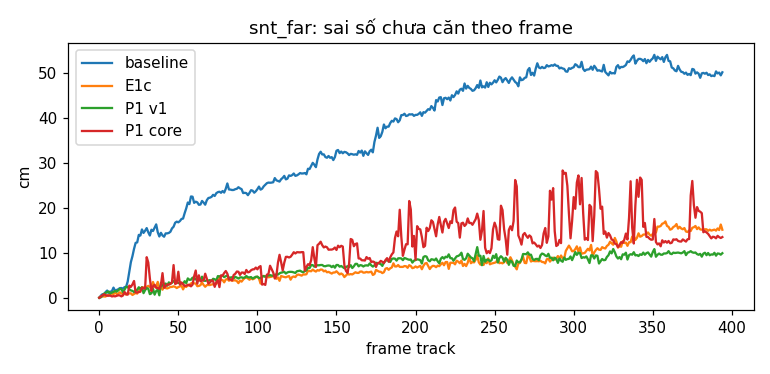
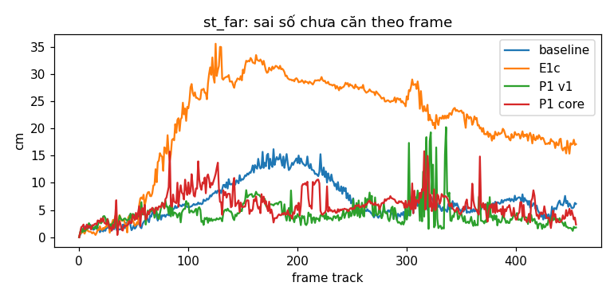
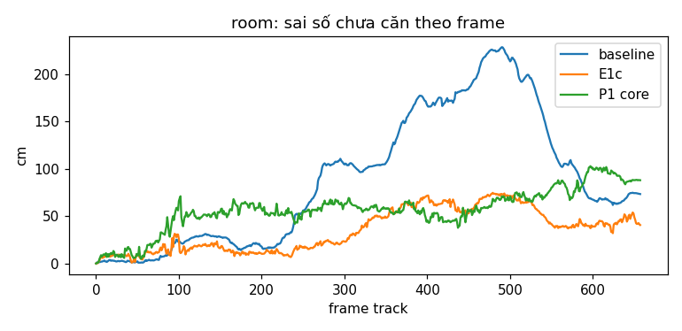

# REPORT A2G-P1 core: ATE của plane world (một mô hình độ bất định) so với baseline và E1c

Sinh tự động từ dữ liệu (`tools/a2g_p1/compare_core.py`). 1 seed; hai run cùng code đã lệch nhau 5–12 cm (T7), hai run baseline trên snt_far cho 14,64 / 12,63 cm; chênh lệch ATE dưới khoảng 15 % ghi là **trong nhiễu**. P1 v1 và P1 core khác nhau ở plane world nhưng cùng frontend, nên so được trực tiếp.

## snt_far

| Chỉ số | baseline | E1c | P1 v1 | P1 core |
|---|---|---|---|---|
| ATE mọi frame (cm) | 14,64 | 3,80 | 3,20 | 7,54 |
| ATE keyframe (cm) | 13,61 | 3,73 | 3,21 | 9,79 |
| RPE Δ1 (cm) | 1,04 | 0,90 | 0,90 | 4,52 |
| Sai số chưa căn cuối (cm) | 50,2 | 15,2 | 9,9 | 13,5 |
| Sai số chưa căn lớn nhất (cm) | 54,1 | 17,0 | 11,3 | 28,4 |
| % frame khởi tạo bằng plane | — | 48,5 | 52,0 | 7,6 |
| ms/frame tracking | 2273 | 2608 | 2635 | 2558 |
| ms/frame plane world | — | — | 7,4 | 13,2 |

## st_far

| Chỉ số | baseline | E1c | P1 v1 | P1 core |
|---|---|---|---|---|
| ATE mọi frame (cm) | 6,12 | 10,57 | 3,54 | 4,07 |
| ATE keyframe (cm) | 5,93 | 9,45 | 5,38 | 3,90 |
| RPE Δ1 (cm) | 1,17 | 1,77 | 3,04 | 3,24 |
| Sai số chưa căn cuối (cm) | 6,1 | 17,1 | 1,8 | 2,3 |
| Sai số chưa căn lớn nhất (cm) | 16,2 | 35,6 | 20,2 | 15,8 |
| % frame khởi tạo bằng plane | — | 41,1 | 38,5 | 18,0 |
| ms/frame tracking | 1764 | 2618 | 2479 | 2400 |
| ms/frame plane world | — | — | 8,3 | 11,0 |

## room

| Chỉ số | baseline | E1c | P1 v1 | P1 core |
|---|---|---|---|---|
| ATE mọi frame (cm) | 71,80 | 29,72 | — | 45,18 |
| ATE keyframe (cm) | 70,50 | 30,33 | — | 44,54 |
| RPE Δ1 (cm) | 1,99 | 3,39 | — | 5,45 |
| Sai số chưa căn cuối (cm) | 73,4 | 40,7 | — | 88,0 |
| Sai số chưa căn lớn nhất (cm) | 228,7 | 74,7 | — | 102,8 |
| % frame khởi tạo bằng plane | — | 25,6 | — | 3,7 |
| ms/frame tracking | 1584 | 2361 | — | 2284 |
| ms/frame plane world | — | — | — | 161,5 |

## Tóm tắt

- **snt_far:** P1 core 7,54 cm; so với E1c 3,80 cm: 98,4 % (tệ hơn); so với baseline 14,64 cm: -48,5 % (tốt hơn).
- **st_far:** P1 core 4,07 cm; so với E1c 10,57 cm: -61,5 % (tốt hơn); so với baseline 6,12 cm: -33,4 % (tốt hơn).
- **room:** P1 core 45,18 cm; so với E1c 29,72 cm: 52,0 % (tệ hơn); so với baseline 71,80 cm: -37,1 % (tốt hơn).

## Phụ lục: chỉ số plane world không cần nhãn

| Chuỗi | Phương pháp | Anchor primary cuối | Active cuối | Cặp gần trùng ở cuối | Đổi ID: bản trùng | Đổi ID: nghi ghép sai | Gộp |
|---|---|---|---|---|---|---|---|
| snt_far | E1c | 22 | 16 | 24 | 126 | 30 | — |
| snt_far | P1 v1 | 6 | 6 | 1 | 26 | 0 | 6 |
| snt_far | P1 core | 29 | 23 | 25 | 117 | 226 | 0 |
| st_far | E1c | 30 | 18 | 18 | 99 | 59 | — |
| st_far | P1 v1 | 6 | 6 | 1 | 1 | 0 | 15 |
| st_far | P1 core | 25 | 20 | 16 | 127 | 153 | 2 |
| room | E1c | 428 | 225 | 595 | 460 | 151 | — |
| room | P1 core | 504 | 263 | 1031 | 465 | 751 | 18 |

| Chuỗi | P1 core: NIS IC dữ liệu mới (TB / trung vị, n) | NIS IC dữ liệu cũ (TB, n) | NIS ghép lại keyframe dữ liệu mới (TB, n) | % cặp không mơ hồ | b̂ trung vị (góc °, offset mm) | Hoãn | revisit_candidate | Mẫu b̂ nhận / từ chối / mơ hồ |
|---|---|---|---|---|---|---|---|---|
| snt_far | 2,23 / 1,44 (892) | 2,45 (518) | 3,54 (51) | 25,7 | 0,162, 2,63 | 12 | 6 | 288 / 75 / 1047 |
| st_far | 2,74 / 1,81 (1270) | 2,26 (306) | 3,14 (76) | 47,3 | 0,209, 1,23 | 6 | 2 | 581 / 165 / 830 |
| room | 2,56 / 1,61 (2514) | 2,96 (494) | 3,94 (648) | 25,9 | 0,000, 0,00 | 158 | 72 | 407 / 372 / 2229 |

## Phụ lục: test, σ₀, smoke, run, hạn chế

**Code:** nhánh `exp/a2g-p1core` (từ `ec92002`): `0739e8c` (API độ bất định, vòng đời tối thiểu, hoãn), `fbcb5e4` (fit segment có trọng số theo ô, σ₀ khóa), `b843588` (config room), `6e14aca` (tool). Frontend không đổi so với `ec92002` (T9).

**Test (CPU, chỉ để báo cáo):**

| Test | Kết quả |
|---|---|
| T1 Jacobian, z = −J_b⁻¹r, hàng h_c của R_s | Đạt (sai số tương đối ≤ 6,7e-9) |
| T2 R_s Monte-Carlo (σ₀ = 0) | Thẳng mặt 2 m: 3,04; ô nhỏ 8 ô ở 4 m: 3,07 (đạt). Xiên 60° (2–5 m): 3,17; xiên 75° (2–6 m): 3,24 (**trượt** ngưỡng ±5 %). Công thức cũ: 3,04 / 3,07 / 11,57 / 238,8 |
| T3 IC, gộp hai bản trùng, JC | Đạt: IC 3,06 (loại nhầm 1,2 %), gộp 2,90 (0,6 %), shape 6,09, jump 5,89, shape + jump = total |
| T3b ghép (Hungarian theo ln det S, anchor quay lưng) | Đạt |
| T4 OffsetEstimator | Đạt: b̂ trong vùng 2σ ở 187/200 lần; mẫu sai (4 cm) bị từ chối; cặp mơ hồ không thành mẫu; f tăng (1,32) khi độ lệch đổi |
| T5 CAPE-lite không đổi | Đạt |
| T6 gộp trong frame | Đạt |
| T7 JC và khởi tạo | Đạt (cặp sai bị bỏ, lệch 30 cm → jump trượt, 2 mặt → không khởi tạo, GN dùng anchor gốc) |
| T8 cảnh tổng hợp, mô hình A, σ₀ khóa | **Trượt.** 0 gộp nhầm ở mọi kiểu và seed; NIS IC (dữ liệu mới) 2,50–3,07 (đạt). Nhưng có cặp sai **phân biệt được** lọt vào ràng buộc pose: E0 0/5 seed, E1 5/5 (33–45 cặp), E2 3/5, E3 0/5, E4 4/5. Bản trùng còn sót (thường ở tường B/tấm P15, tường C): E0 1/5, E1–E4 gần như mọi seed. E4: ≥ 1 `revisit_candidate` ở 5/5 seed. A/P4 dưới độ phân giải: độ chính xác 74–99,8 % |
| T8 mô hình B (độ bền) | Gán đúng 86,8–100 %; 0 gộp nhầm; NIS 1,4–2,2 |
| T9 kiểm tĩnh (I11, I12, frontend) | Đạt |

**σ₀:** hiệu chỉnh trên fr3/structure_notexture_near, 0–120 bước 2, 3 smoke (`results_exp/a2g_p1core/calib/snt_near_r{1,2,3}`):

| Lần | σ_θ0 / σ_d0 | NIS góc (mục tiêu 2) | NIS khoảng cách (mục tiêu 1) | Số cặp |
|---|---|---|---|---|
| r1 | 0,5° / 5 mm | 0,44 | 1,85 | 8 |
| r2 | 0,235° / 6,8 mm | 0,49 | 0,77 | 5 |
| r3 | 0,116° / 6,0 mm | 1,49 | 2,39 | 5 |

Khóa ở **0,116° / 6,0 mm** (lần chỉnh cuối được phép). Hiệu chỉnh yếu: mỗi lần chỉ 5–8 cặp không mơ hồ, có dữ liệu mới ở keyframe.

**Smoke có `--pw-debug`:** cả 3 chuỗi chạy hết, không assert, 0 vi phạm bất biến khi kiểm lại trên log.

**Run chính:** không run nào crash. snt_far 1060 s, st_far 1134 s, room 2194 s. Kiểm bất biến trên log: snt_far 0, st_far 0, **room 410 dòng (205 sự kiện I9)**. Lỗi sổ sách: một candidate đã nhận anchor khác gộp vào, rồi bị xóa theo luật L, để lại anchor phụ trỏ tới primary không còn. Anchor phụ không tham gia quyết định nào nên không ảnh hưởng tracking; chưa sửa trong vòng này.

**Chi phí plane world:** snt_far 13 ms/frame, st_far 11 ms/frame, **room 162 ms/frame** (p95 352 ms). Trên room có 504 anchor primary ở cuối (263 active), 252 candidate bị xóa, 158 lần hoãn: CAPE-lite trên fr1/room sinh nhiều segment nhỏ. Thời gian này cộng thẳng vào thời gian chạy (room 2194 s so với E1c 1960 s).

**Run dùng lại** (đủ file cho ATE theo `check_run_files.py`; baseline snt_far chỉ thiếu 2 cột timing không dùng):

| Chuỗi | baseline | E1c | P1 v1 |
|---|---|---|---|
| snt_far | `results_exp/e1/fr3_snt_far/base/seed0` (b46da10) | `results_exp/e1c/fr3_snt_far/dec/seed0` (6458256) | `results_exp/a2g_p1q/snt_far/p1/seed0` (c80ff00 + code v1) |
| st_far | `results_exp/e1f/fr3_st_far/base/seed0` (dd70c14) | `results_exp/e1f/fr3_st_far/dec/seed0` (dd70c14) | `results_exp/a2g_p1q/st_far/p1/seed0` |
| room | `results_exp/e1f/fr1_room/base/seed0` (dd70c14, `configs/tum/e1/fr1_room.yaml`) | `results_exp/e1f/fr1_room/dec/seed0` (dd70c14) | — |

Config room dùng lại có cùng calibration fr1 (`distorted: True`), cùng `e1_common` (bước frame 2, loop tắt) với config mới; chỉ khác `sequence_name`.

**Hạn chế fr1/room (kiểm 5 frame):** dataset loader chỉ undistort ảnh màu, depth giữ nguyên bị méo, trong khi CAPE-lite chiếu ngược depth bằng cùng K. Độ dời pixel của phép undistort: trung bình 5,3 px, 95 % ≤ 11,6 px, lớn nhất 36,8 px. Depth tại cùng pixel lệch trung vị 4 mm, phân vị 90 % là 1,5–2,1 cm. Ảnh hưởng như nhau tới E1c, P1 core và baseline (baseline không dùng plane).

**Khác plan và vì sao:**

1. **Không chạy mới E1c trên room**, dùng lại `results_exp/e1f/fr1_room/dec/seed0`: plan ghi "chưa có" nhưng run này có sẵn (cùng chỗ với baseline room, đủ file). Tiết kiệm khoảng 33 phút GPU. Run này chạy ở dd70c14, khác commit P1 core, nhưng cùng đường E1c.
2. **Fit segment có trọng số 1/σ_c² trên tâm ô** (thay vì PCA không trọng số trên mọi pixel), để R_s = I⁻¹ đúng là covariance của phép fit thực sự dùng. Trước khi sửa, T2 xiên 60°/75° cho NIS 6,7/36. PlaneMeas của E1c không đổi (T5).
3. **T5** kiểm "tổng thống kê theo ô bằng thống kê segment" qua điều kiện tâm nằm trên mặt, thay vì so pháp tuyến (fit của P1 core có trọng số nên pháp tuyến khác PlaneMeas).
4. **Bỏ phần kiểm luật xung đột trong T3b**, vì trạng thái xung đột đã bỏ theo plan.
5. **"Trong tầm nhìn"** khi xóa candidate dùng số hạng σ_ρ = 0 (plan: bỏ số hạng drift; không có mô hình độ lệch tăng theo thời gian).
6. **T8:** E0–E4 dùng lại các kiểu drift của harness cũ (P8, P1, P5, P3, P7). Phân loại "phân biệt được" dùng phần dư giữa hai mặt thật tại tâm segment, trong hệ camera thật, với S thực sự đã dùng ở phép thử đó.

