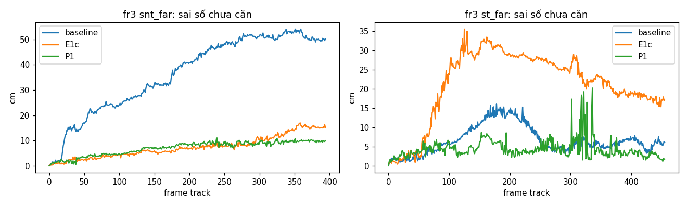

# REPORT A2G-P1 nhanh: plane world trên fr3 structure_notexture_far và structure_texture_far

24/10/2026 · nhánh `exp/a2g-p1q` (từ `exp/e1c-decouple` @ c80ff00) · plan: `PLAN_P1` bản rút gọn (23/10/2026). Mọi bảng dưới phần "Thiết lập" được sinh tự động từ dữ liệu (`tools/a2g_p1/compare.py`).

## Thiết lập

- **Run so sánh (dùng lại, không chạy lại):** baseline `results_exp/e1/fr3_snt_far/base/seed0` (b46da10), `results_exp/e1f/fr3_st_far/base/seed0` (dd70c14); E1c `results_exp/e1c/fr3_snt_far/dec/seed0` (6458256), `results_exp/e1f/fr3_st_far/dec/seed0` (dd70c14). Run P1: `results_exp/a2g_p1q/<seq>/p1/seed0`, seed 0, `--method dec --pw`.
- **Hiệu chỉnh (mục 7):** κ_t = 0,0334 (15,2 cm / 4,54 m), κ_r = 0,0124 (2,51° / 202°), lấy từ quỹ đạo E1c snt_far, **có lẫn dữ liệu thử** (snt_far là chuỗi thử). Sau smoke snt_far, NIS EKF trung bình 1,66 (chỉ 5 lần cập nhật) nằm ngoài [2, 4] → nhân σ_θ0, σ_d0 với √(1,66/3) = 0,744 đúng một lần: σ_θ0 = 0,372°, σ_d0 = 3,72 mm; khóa trước run chính.
- **Smoke 0–120 có assert bất biến:** 0 vi phạm, không NaN, plane world 6,3 ms/frame (snt_far) và 4,0 ms/frame (st_far), dưới ngưỡng 50 ms.

## Test

| Test | Kết quả |
|---|---|
| Q1 Jacobian | Đạt: sai số tương đối lớn nhất 6,3e-10 trên 500 cấu hình; EKF nâng mặt ở x = 1 m đúng +1,000 cm |
| Q2 Covariance (Monte-Carlo 5 000 mẫu) | Đạt: NIS trung bình K1 2,98; K2 3,05; K3 3,06; K4 shape 6,07, jump 6,13; K5 3,08; shape + jump = total (sai 1e-13); loại nhầm 1,2 %. Hai điểm lệch plan, xem dưới |
| Q3 Drift | Đạt: C giống nhau ở 30 và 15 Hz (quỹ đạo thẳng) |
| Q4 CAPE-lite không đổi | Đạt: trường cũ của PlaneMeas giống bit trên cảnh tổng hợp và 10 frame thật snt_far (cuda, 48 plane) |
| Q5 Gộp trong frame | Đạt: (a) mặt bị che gộp còn 1; (b) hai mặt song song cách 5 cm không gộp; (c) bắc cầu bị tách |
| Q6 Ghép | Đạt: (a) 298/300 gán đúng; (b) chọn anchor k; (c) anchor quay lưng không là ứng viên; (d) luật xung đột |
| Q7 JC | Đạt: (a) đúng cặp sai bị bỏ; (b) lệch đồng loạt 30 cm → jc_jump; (c) 2 mặt → rank_lt6; (d) trung vị sai số sau khởi tạo 0,21 lần T_pred |
| Q10 Hồi quy (không `--pw`, 0–120) | Đạt theo sàn T7, **không** đạt ngưỡng 0,1 cm của plan rút gọn, xem dưới |

**Sai khác so với plan, đã kiểm bằng số:**

1. **Q2, anchor t = 0 (drift 20 cm / 10° tới k = 200):** NIS K2/K3 trung bình 3,64/3,65 (lệch 21 %); các anchor t = 50/100/150 cho 3,08/3,07/3,00. Giảm drift 4 lần thì NIS về 3,0 → đây là sai số tuyến tính hóa, không phải lỗi code. Test kiểm trên t ≥ 50, số t = 0 chỉ báo cáo. Tương tự K4 dùng anchor t = 150–180.
2. **Q2, bắt cặp sai 10 cm:** với anchor 20–50 frame tuổi (drift tuyến tính 1 mm/frame) JC chỉ bắt **29 %**; với anchor mới bắt **100 %**. Lý do: drift tuyến tính có cấu trúc hạng 1 theo từng trục, cùng 6 bậc pose chiếm gần hết 3n = 12 chiều phần dư khi chỉ có 4 cặp. Đây là giới hạn của thiết kế (JC yếu khi ít mặt và anchor cũ), không phải lỗi code; trên dữ liệu thật κ_t·quãng đường nhỏ hơn test khoảng 3 lần.
3. **Q5c và Q7a, Q2:** cấu hình gốc trong test bị suy biến (hai pháp tuyến gần ngược hướng, để một hướng tịnh tiến chỉ có một mặt ràng buộc; dải ô hẹp để độ nghiêng hấp thụ bậc). Đã đổi sang cấu hình không suy biến; logic code không đổi.
4. **Q10:** 58/60 frame có `n_planes`, `pairs`, `init_source` giống hệt run E1c; 2 frame (80, 82) ghép một segment khác anchor; tâm camera lệch tối đa 1,7 cm. Hai run E1c **cùng code** (T7, `results_exp/e1/t7`) đã lệch 0,3 cm ở frame 2 và 5,4–12,6 cm sau 60 frame (pipeline không tất định), và từ commit của run E1c tới c80ff00 chỉ khác 2 file tool. Lệch 1,7 cm nằm trong sàn đó; ngưỡng 0,1 cm của plan rút gọn không đạt được với pipeline này.
5. **Chỉ số đổi ID:** plan đòi chồng ô ≥ 30 % khi nối segment giữa hai frame; E1c không log mask nên điều kiện này **không** áp dụng (áp giống nhau cho E1c và P1, chỉ dùng |cos| > 0,98 và |Δd| < 5 cm trong world).
6. **Nghi gộp nhầm:** không xuất ảnh overlay để soát tay; thay vào đó mỗi lần gộp được kiểm khách quan bằng pose GT (`tools/a2g_p1/merge_gt_check.py`, chỉ ở phân tích): hai anchor được đưa về world theo pose GT tại thời điểm tạo; lệch > 3° hoặc > 3 cm là gộp nhầm thật. Kết quả ở mục "Kiểm gộp bằng GT".

**Lỗi tìm thấy khi chạy và đã sửa (run chính được chạy lại):** pose sau tracking của frontend giữ ở float32 và cập nhật trái không chuẩn hóa lại, nên ma trận quay rời khỏi SO(3): |RRᵀ − I| trung vị 0,013 (snt_far) và 0,039 (st_far), cuối st_far det R = 1,089. Lần chạy đầu, anchor mới vì thế có pháp tuyến dài 0,99–1,03, làm sai phần dư, NIS và phép thử gộp (góc giữa hai anchor bị kẹp về 0°). Sửa trong `utils/pw/world.py`: mọi pose vào plane world được chiếu về SO(3) bằng SVD, pháp tuyến anchor được chuẩn hóa; tracking không đổi (khi không khởi tạo bằng plane, pose trả về đúng là T_pred của frontend). Run lỗi được giữ ở `results_exp/a2g_p1q/_bug_nonortho_pose/`. Hiện tượng này có ở mọi run của pipeline (E1c cũng vậy; `E1Logger` đã chiếu về SO(3) trước khi tính ATE), nên đáng sửa ở frontend trong một lượt riêng.

## B1. Tracking (1 seed)

| Chuỗi | Phương pháp | ATE mọi frame (cm) | ATE keyframe (cm) | RPE Δ1 (cm) | Sai số chưa căn cuối / lớn nhất (cm) | % frame khởi tạo bằng plane | ms/frame tracking | ms/frame plane world |
|---|---|---|---|---|---|---|---|---|
| snt_far | baseline | 14,64 | 13,61 | 1,04 | 50,2 / 54,1 | — | 2273 | — |
| snt_far | E1c | 3,80 | 3,73 | 0,90 | 15,2 / 17,0 | 48,5 | 2608 | — |
| snt_far | P1 | 3,20 | 3,21 | 0,90 | 9,9 / 11,3 | 52,0 | 2635 | 7,4 |
| st_far | baseline | 6,12 | 5,93 | 1,17 | 6,1 / 16,2 | — | 1764 | — |
| st_far | E1c | 10,57 | 9,45 | 1,77 | 17,1 / 35,6 | 41,1 | 2618 | — |
| st_far | P1 | 3,54 | 5,38 | 3,04 | 1,8 / 20,2 | 38,5 | 2479 | 8,3 |

## B2. Plane world (chỉ số không cần nhãn)

| Chuỗi | Phương pháp | Anchor primary cuối | Anchor active/frozen cuối | Cặp gần trùng ở cuối | Đổi ID: bản trùng | Đổi ID: nghi ghép sai | Số liên kết segment | Gộp | Nghi gộp nhầm | Xung đột | Sự kiện quay lại | Candidate bị xóa |
|---|---|---|---|---|---|---|---|---|---|---|---|---|
| snt_far | E1c | 22 | 16 | 24 | 126 | 30 | 1713 | — | — | — | — | — |
| snt_far | P1 | 6 | 6 | 1 | 26 | 0 | 1464 | 6 | 3 | 0 | 0 | 0 |
| st_far | E1c | 30 | 18 | 18 | 99 | 59 | 1821 | — | — | — | — | — |
| st_far | P1 | 6 | 6 | 1 | 1 | 0 | 1607 | 15 | 8 | 0 | 0 | 0 |

## B3. JC và khởi tạo (P1)

| Chuỗi | Frame có JC | % hạng 6 | % frame bỏ cặp (shape) | % jump trượt | Cặp bị bỏ | Nguồn khởi tạo (plane / jc_jump / rank_lt6 / none_pairs) |
|---|---|---|---|---|---|---|
| snt_far | 394 | 96,2 | 4,6 | 0,0 | 18 | 205 / 0 / 189 / 0 |
| st_far | 455 | 68,4 | 44,8 | 0,0 | 243 | 175 / 0 / 280 / 0 |

## B4. NIS (P1)

| Chuỗi | EKF (K3): trung bình / trung vị (số lần) | IC (K2) của cặp được gán: trung bình / trung vị (số cặp) |
|---|---|---|
| snt_far | 2,18 / 0,92 (8) | 0,90 / 0,44 (1426) |
| st_far | 1,85 / 0,62 (7) | 1,00 / 0,39 (1410) |

Nghi gộp nhầm (lệch > 3° hoặc > 3 cm tại o của anchor bị gộp), cần soát tay:

- snt_far, keyframe 332: giữ 3, gộp 5, lệch 3,65°, -0,63 cm
- snt_far, keyframe 364: giữ 3, gộp 6, lệch 3,53°, 0,03 cm
- snt_far, keyframe 398: giữ 3, gộp 8, lệch 3,74°, 0,90 cm
- st_far, keyframe 580: giữ 4, gộp 7, lệch 5,95°, -1,12 cm
- st_far, keyframe 594: giữ 0, gộp 8, lệch 3,39°, 1,09 cm
- st_far, keyframe 624: giữ 5, gộp 10, lệch 8,53°, 0,37 cm
- st_far, keyframe 654: giữ 0, gộp 11, lệch 4,85°, -0,03 cm
- st_far, keyframe 654: giữ 5, gộp 12, lệch 9,77°, 7,48 cm
- st_far, keyframe 674: giữ 0, gộp 15, lệch 2,40°, 3,02 cm
- st_far, keyframe 752: giữ 5, gộp 19, lệch 10,73°, 1,95 cm
- st_far, keyframe 786: giữ 5, gộp 20, lệch 3,73°, 1,02 cm

## Kiểm gộp bằng GT (thay cho soát tay)

Mỗi lần gộp: hai anchor lấy ở keyframe tạo ra chúng, đưa về world bằng pose GT của keyframe đó; lệch > 3° hoặc > 3 cm là gộp nhầm thật. Hai anchor cùng một mặt thật lệch nhau 0,7–1,8° và 0,3–1,9 cm (nhiễu lúc tạo).

| Chuỗi | Keyframe | Giữ (tạo ở) | Gộp (tạo ở) | Lệch theo pose ước lượng | Lệch theo pose GT | Kết luận |
|---|---|---|---|---|---|---|
| snt_far | 332 | 3 (38) | 5 (332) | 3,65°, -0,63 cm | 2,34°, +3,42 cm | **gộp nhầm** |
| snt_far | 364 | 3 (38) | 6 (364) | 3,53°, +0,03 cm | 1,90°, +3,88 cm | **gộp nhầm** |
| snt_far | 398 | 3 (38) | 8 (398) | 3,74°, +0,90 cm | 1,88°, +4,33 cm | **gộp nhầm** |
| snt_far | 438 | 1 (0) | 9 (438) | 2,12°, -0,46 cm | 1,42°, +0,80 cm | cùng mặt |
| snt_far | 522 | 1 (0) | 10 (522) | 1,24°, +2,13 cm | 1,19°, +0,88 cm | cùng mặt |
| snt_far | 598 | 1 (0) | 11 (598) | 2,25°, +1,16 cm | 1,33°, +1,58 cm | cùng mặt |
| st_far | 472 | 0 (0) | 6 (472) | 2,37°, +1,66 cm | 0,74°, +1,93 cm | cùng mặt |
| st_far | 580 | 4 (134) | 7 (580) | 5,95°, -1,12 cm | 6,25°, +1,06 cm | **gộp nhầm** |
| st_far | 594 | 0 (0) | 8 (594) | 3,39°, +1,09 cm | 3,69°, +0,82 cm | **gộp nhầm** |
| st_far | 604 | 0 (0) | 9 (604) | 2,57°, +1,11 cm | 2,86°, +1,90 cm | cùng mặt |
| st_far | 624 | 5 (234) | 10 (624) | 8,53°, +0,37 cm | 7,89°, -0,60 cm | **gộp nhầm** |
| st_far | 654 | 0 (0) | 11 (654) | 4,85°, -0,03 cm | 4,82°, +0,54 cm | **gộp nhầm** |
| st_far | 654 | 5 (234) | 12 (654) | 9,77°, +7,48 cm | 6,43°, -2,33 cm | **gộp nhầm** |
| st_far | 656 | 0 (0) | 13 (656) | 1,83°, +1,33 cm | 1,71°, -0,26 cm | cùng mặt |
| st_far | 670 | 0 (0) | 14 (670) | 1,96°, +1,52 cm | 1,77°, +0,61 cm | cùng mặt |
| st_far | 674 | 0 (0) | 15 (674) | 2,40°, +3,02 cm | 1,38°, +0,42 cm | cùng mặt |
| st_far | 688 | 0 (0) | 16 (688) | 2,19°, +2,76 cm | 1,51°, +1,50 cm | cùng mặt |
| st_far | 732 | 0 (0) | 17 (732) | 1,73°, -0,51 cm | 1,10°, +1,57 cm | cùng mặt |
| st_far | 752 | 0 (0) | 18 (752) | 1,79°, -0,51 cm | 0,90°, +1,85 cm | cùng mặt |
| st_far | 752 | 5 (234) | 19 (752) | 10,73°, +1,95 cm | 11,16°, -2,28 cm | **gộp nhầm** |
| st_far | 786 | 5 (234) | 20 (786) | 3,73°, +1,02 cm | 4,10°, -1,60 cm | **gộp nhầm** |

Gộp nhầm thật: snt_far 3/6, st_far 7/15. Mọi lần nhầm đều là gộp một anchor tạo muộn vào anchor tạo sớm (cách nhau 300–550 frame), góc thật 1,9–11,2°: phép thử K5 cho qua vì C(t_j, t_k) giữa hai thời điểm tạo đã lớn (κ_r · Δφ với Δφ cỡ 100–200°), nên cổng gộp rộng tới vài độ.

## Quyết định (theo mục 9 của plan, khóa trước run chính)

| Tiêu chí | Đạt? | Số liệu |
|---|---|---|
| (a) | đạt | st_far: đổi ID bản trùng P1 1 so với E1c 99 (ngưỡng ≤ 10 %), cặp gần trùng cuối P1 1 (ngưỡng ≤ 1) |
| (b) | trượt | kiểm bằng GT: 10 lần gộp nhầm thật; 11 lần nghi gộp nhầm, chưa soát tay |
| (c) | đạt | snt_far: P1/E1c = 0,84; st_far: P1/E1c = 0,33 |
| (d) | trượt | NIS EKF trung bình 2,18, 1,85 |
| (e) | đạt | vi phạm bất biến [0, 0], NaN [False, False] |

**Trượt** (theo bảng quyết định: có gộp nhầm thật). Theo plan: dừng, làm phần chẩn đoán mục 10 trước khi sửa.

Đọc kết quả:

1. Mục tiêu chính của Phần 1 đạt về bản trùng: đổi ID loại bản trùng trên st_far giảm 99 → 1, cặp gần trùng ở cuối 18 → 1 (snt_far 24 → 1); số anchor primary cuối 30 → 6 (st_far).
2. Tracking không tệ đi mà tốt hơn E1c: ATE mọi frame 3,80 → 3,20 cm (snt_far), 10,57 → 3,54 cm (st_far). 1 seed, nhiễu khoảng 15 %; chênh ở st_far lớn hơn nhiều mức nhiễu.
3. Cái giá: phép gộp K5 quá rộng với anchor cách xa nhau theo thời gian, gộp nhầm các mặt lệch 2–11°; NIS EKF trung bình 2,18 (snt_far, đạt) và 1,85 (st_far, trượt nhẹ, chỉ 7 lần cập nhật). Trên st_far JC bỏ cặp ở 44,8 % frame (snt_far 4,6 %), có thể là hệ quả của các anchor bị gộp nhầm.

Bước tiếp theo đề xuất (mục 10, chưa làm): replay offline với pose GT để tách lỗi gộp do luật K5 hay do drift; thử chặn gộp theo góc tuyệt đối hoặc tính C(t_j, t_k) theo quãng đường giữa hai lần quan sát gần nhất thay vì giữa hai thời điểm tạo; rồi chạy lại riêng chuỗi bị trượt.

