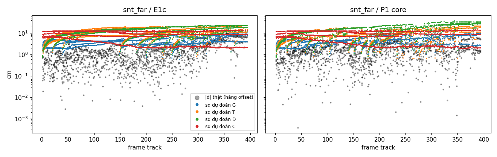

# STAGE0 — A2G-P1 gen, Bước 0: kiểm giả định trên dữ liệu thật

Sinh từ dữ liệu (`tools/a2g_gen/stage0_report.py`). CPU, không chạy SLAM. GT chỉ dùng trong `tools/`. Nhánh `exp/a2g-p1gen` (từ `exp/a2g-p1core` @ 8518042).

**Run dùng lại** (không chạy lại; đủ file theo `check_run_files.py`, riêng baseline snt_far thiếu 2 cột timing không dùng): snt_near E1c `results_exp/e1f/fr3_snt_near/dec/seed0` (cả chuỗi, ATE 9,59 cm); snt_far / st_far / room: base, E1c, P1 core như mục 3.1 của plan.

## 1. A3 — mô hình cảm biến

### A3 — mô hình cảm biến (pose GT, σ₀ = 0)

Cặp "cùng mặt": hai segment cách nhau ≤ 10 frame track, góc world ≤ 3°, hai offset ≤ 3 cm, ≥ 1 ô chung lưới 5 cm (chỉ để gán nhãn). NIS₃ của r(s_a | s_b) với S = J_a R_a J_aᵀ + J_b R_b J_bᵀ; kỳ vọng trung bình 3, % > χ²₃(0,99) = 11,34 là 1 %.

| Chuỗi | Frame | Segment | Cặp | NIS TB (thô) | NIS trung vị (thô) | % > χ² (thô) | NIS TB (sau khóa) | NIS trung vị (sau khóa) | % > χ² (sau khóa) |
|---|---|---|---|---|---|---|---|---|---|
| snt_near | 530 | 2022 | 18455 | 2607,4 | 482,4 | 92,1 | 3,00 | 0,74 | 6,4 |
| snt_far | 395 | 1856 | 18447 | 265,5 | 44,6 | 70,7 | 0,92 | 0,19 | 0,9 |
| st_far | 456 | 2060 | 20176 | 467,6 | 73,2 | 78,0 | 1,19 | 0,33 | 1,0 |
| room | 658 | 4006 | 23114 | 1117,6 | 199,8 | 89,3 | 3,07 | 0,68 | 7,1 |

**NIS thô theo khoảng cách tâm segment tới tâm ảnh (lớn hơn của hai segment)** (TB / % > χ², số cặp):

| Chuỗi | < 150 px | 150–250 px | > 250 px |
|---|---|---|---|
| snt_near | 3470,4 / 99 % (9059) | 2663,0 / 91 % (5100) | 721,4 / 79 % (4296) |
| snt_far | 371,4 / 77 % (5189) | 245,2 / 71 % (10435) | 145,8 / 58 % (2823) |
| st_far | 801,5 / 87 % (8730) | 227,7 / 73 % (9260) | 150,3 / 67 % (2186) |
| room | 1435,0 / 93 % (4968) | 1153,1 / 89 % (13415) | 683,8 / 87 % (4731) |

**NIS thô theo độ sâu (trung bình hai tâm)** (TB / % > χ², số cặp):

| Chuỗi | < 1 m | 1–2 m | 2–3 m | ≥ 3 m |
|---|---|---|---|---|
| snt_near | 3607,6 / 98 % (11489) | 957,7 / 82 % (6966) | — / — % (0) | — / — % (0) |
| snt_far | — / — % (0) | 356,9 / 87 % (13385) | 23,6 / 28 % (5062) | — / — % (0) |
| st_far | — / — % (0) | 799,6 / 92 % (9800) | 154,0 / 65 % (10375) | 0,1 / 0 % (1) |
| room | 2146,6 / 95 % (6863) | 785,7 / 91 % (13757) | 122,6 / 68 % (2379) | 10,5 / 31 % (115) |

**NIS thô theo độ dư của fit χ²_fit/dof (lớn hơn của hai segment)** (TB / % > χ², số cặp):

| Chuỗi | < 1 | 1–2 | 2–5 | ≥ 5 |
|---|---|---|---|---|
| snt_near | 50,1 / 51 % (1083) | 262,2 / 74 % (1809) | 1701,1 / 95 % (8793) | 4820,2 / 100 % (6770) |
| snt_far | 55,3 / 37 % (6621) | 251,6 / 84 % (5733) | 412,7 / 94 % (5056) | 966,3 / 97 % (1037) |
| st_far | 70,5 / 56 % (7984) | 176,9 / 86 % (5180) | 1098,5 / 97 % (5917) | 1328,0 / 99 % (1095) |
| room | 330,8 / 79 % (7189) | 657,1 / 90 % (4905) | 1381,6 / 94 % (5169) | 2237,3 / 98 % (5851) |

**NIS thô theo số ô CAPE của segment nhỏ hơn (chẩn đoán thêm, ngoài plan)** (TB / % > χ², số cặp):

| Chuỗi | < 10 | 10–50 | 50–200 | ≥ 200 |
|---|---|---|---|---|
| snt_near | 628,7 / 70 % (332) | 685,5 / 78 % (5676) | 4948,1 / 99 % (4178) | 2823,4 / 99 % (8269) |
| snt_far | 15,9 / 14 % (870) | 163,2 / 45 % (5998) | 376,1 / 89 % (9109) | 193,6 / 85 % (2470) |
| st_far | 30,4 / 23 % (659) | 173,8 / 61 % (7454) | 357,5 / 88 % (7926) | 1277,5 / 98 % (4137) |
| room | 259,2 / 81 % (2062) | 959,0 / 87 % (15187) | 1848,4 / 98 % (5505) | 1555,2 / 100 % (360) |

**Quyết định** (theo thứ tự của plan):

- **a (room, thô):** NIS TB dải ngoài 683,8 / dải trong 1435,0 = 0,48 lần ≤ 1,5: không undistort.
- **b (snt_near):** tương quan hạng Spearman giữa NIS và χ²_fit/dof = 0,543 (p = 0.0e+00) → **bật** hệ số fit-excess R_s ← R_s·max(1, χ²_fit/dof); NIS TB sau b = 432,3.
- **c (snt_near):** λ_s = NIS TB / 3 = 144,1 → khóa **λ_s = 144,1** (R_s nhân λ_s).
- **Khối `PlaneWorld.sensor` khóa:** `undistort_depth: false`, `fit_excess: true`, `lambda_s: 144.1`.

## 2. A1 / A2 — gia phả sai số

ε thật = Log(T_cw⁻¹ T̂_cw) theo frame, không căn quỹ đạo. Pixel thưa bước 8 px (80×60), depth 0,1–4 m. Chủ sở hữu theo 4 luật; Q_mot theo M5 (30 chuyển động gần nhất); λ tìm trên lưới log 10^-1 … 10^5 (bước 0,1 thập phân) bằng ML của E-local. E-local: NIS₆ (kỳ vọng 6). E-rel: d = J_ε(ε_k − ε_t(j)) cho mọi cặp pose của frame k; NIS₃ (kỳ vọng 3, % > χ²₃(0,99) kỳ vọng 1 %) và NLL trung bình mỗi cặp (thấp hơn là tốt hơn) của gia phả G và ba mô hình T (random walk theo thời gian), D (theo quãng đường), C (hằng số), fit ML trên snt_near.

### 2.1 Chọn biến thể trên snt_near (run E1c)

| Luật chủ | Ảnh màu | Cha mẹ anchor | λ fit (E-local) | NIS₆ TB | NIS₆ trung vị | E-rel NIS₃ TB | % > χ² | NLL G |
|---|---|---|---|---|---|---|---|---|
| P-closest | không | không | 7,9·10^4 | 8,45 | 4,84 | 3,73 | 4,4 | -5,439 |
| P-closest | không | có | 7,9·10^4 | 8,45 | 4,84 | 3,73 | 4,4 | -5,438 |
| P-closest | có | không | 10^5 (biên) | 11,93 | 7,05 | 5,65 | 6,6 | -5,095 |
| P-closest | có | có | 10^5 (biên) | 11,93 | 7,05 | 5,66 | 6,6 | -5,095 |
| P-first | không | không | 10^5 (biên) | 9,77 | 5,98 | 3,69 | 4,5 | -5,691 |
| P-first | không | có | 10^5 (biên) | 9,77 | 5,98 | 3,69 | 4,5 | -5,691 |
| P-first | có | không | 10^5 (biên) | 19,63 | 10,61 | 6,15 | 7,6 | -5,209 |
| P-first | có | có | 10^5 (biên) | 19,63 | 10,61 | 6,15 | 7,6 | -5,209 |
| P-closest-act | không | không | 7,9·10^4 | 8,44 | 4,81 | 3,56 | 4,4 | -5,344 |
| P-closest-act | không | có | 7,9·10^4 | 8,44 | 4,81 | 3,56 | 4,4 | -5,344 |
| P-closest-act | có | không | 10^5 (biên) | 11,77 | 6,75 | 5,37 | 6,6 | -5,033 |
| P-closest-act | có | có | 10^5 (biên) | 11,77 | 6,75 | 5,37 | 6,6 | -5,033 |
| P-first-act | không | không | 10^5 (biên) | 9,53 | 5,80 | 3,52 | 4,2 | -5,649 |
| P-first-act | không | có | 10^5 (biên) | 9,53 | 5,80 | 3,52 | 4,2 | -5,649 |
| P-first-act | có | không | 10^5 (biên) | 17,20 | 9,16 | 5,89 | 7,7 | -5,255 |
| P-first-act | có | có | 10^5 (biên) | 17,20 | 9,16 | 5,89 | 7,7 | -5,255 |

**Khóa:** luật **P-first**, ảnh màu **không**, cha mẹ anchor **không**, **λ = 10^5** (NLL G thấp nhất của E-rel trên snt_near). λ nằm ở **biên trên của lưới plan**; mở rộng lưới tới 10^9 (chỉ chẩn đoán) thì cực trị ở λ ≈ 4·10^5.

Mô hình so sánh fit trên snt_near: Γ (chéo, mỗi frame track) = 1.32e-04, 1.23e-04, 1.40e-05, 4.78e-06, 5.83e-06, 1.74e-05; κ_t² = 7.521e-03 m²/m, κ_r² = 8.566e-04 rad²/rad; Σ₀ đầy đủ 6×6.

### 2.2 Áp biến thể và λ đã khóa cho mọi run

| Chuỗi / run | Frame | KF | σ_c | % pixel có chủ | λ fit riêng (G3) | NIS₆ TB | NIS₆ trung vị | Cặp E-rel | NIS₃ TB | NIS₃ trung vị | % > χ² | NLL G | NLL T | NLL D | NLL C |
|---|---|---|---|---|---|---|---|---|---|---|---|---|---|---|---|
| snt_near / E1c | 530 | 53 | 0,0073 | 77 | 10^5 (biên) | 9,77 | 5,98 | 1828 | 3,69 | 2,56 | 4,5 | -5,691 | -5,892 | -5,686 | -6,918 |
| snt_far / baseline | 395 | 25 | 0,0058 | 90 | 1,6·10^4 | 8,39 | 3,24 | 0 | — | — | — | — | — | — | — |
| snt_far / E1c | 395 | 25 | 0,0056 | 92 | 10^4 | 5,89 | 3,79 | 1612 | 0,78 | 0,21 | 0,0 | -6,811 | -7,098 | -6,842 | -7,193 |
| snt_far / P1 core | 395 | 38 | 0,0066 | 89 | 10^4 | 10,39 | 3,90 | 1410 | 0,77 | 0,31 | 0,9 | -6,731 | -6,288 | -6,232 | -6,543 |
| st_far / baseline | 456 | 34 | 0,0096 | 90 | 10^4 | 5,34 | 3,01 | 0 | — | — | — | — | — | — | — |
| st_far / E1c | 456 | 32 | 0,0150 | 91 | 1,6·10^4 | 9,58 | 6,24 | 1658 | 0,68 | 0,46 | 0,1 | -6,101 | -5,962 | -5,383 | -6,425 |
| st_far / P1 core | 456 | 33 | 0,0152 | 90 | 1,3·10^4 | 10,61 | 4,60 | 1576 | 0,48 | 0,15 | 0,3 | -6,329 | -6,979 | -6,531 | -7,409 |
| room / baseline | 658 | 321 | 0,0256 | 79 | 10^5 (biên) | 31,43 | 5,45 | 0 | — | — | — | — | — | — | — |
| room / E1c | 658 | 290 | 0,0342 | 78 | 10^5 (biên) | 11,06 | 5,86 | 2993 | 3,11 | 1,66 | 4,3 | -5,592 | 18,684 | -4,177 | 3,217 |
| room / P1 core | 658 | 311 | 0,0375 | 72 | 10^5 (biên) | 89,86 | 6,47 | 3008 | 2,99 | 1,43 | 5,3 | -5,376 | 30,056 | -2,800 | 16,715 |

*Hình: snt_far, hàng offset của d. Chấm đen là |d| thật; các dải màu là sd dự đoán của G, T, D, C (thang log).*

### 2.3 Chẩn đoán (chỉ báo cáo, không dùng cho cổng): thang riêng từng run

λ của G fit lại trên E-local của chính run; T, D, C fit lại trên chính các cặp E-rel của run (lợi thế cho T/D/C, vì fit và chấm trên cùng dữ liệu). Câu hỏi: khi thang đã đúng, **cấu trúc** gia phả có tốt hơn không?

| Run | λ riêng | NIS₃ TB | % > χ² | NLL G | NLL T | NLL D | NLL C | Thắng |
|---|---|---|---|---|---|---|---|---|
| snt_near / E1c | 10^5 | 3,69 | 4,5 | -5,691 | -5,892 | -5,686 | -6,918 | C |
| snt_far / E1c | 10^4 | 4,56 | 11,2 | -7,141 | -8,698 | -8,541 | -9,123 | C |
| snt_far / P1 core | 10^4 | 2,87 | 2,7 | -7,874 | -6,506 | -6,609 | -7,747 | G |
| st_far / E1c | 1,6·10^4 | 1,80 | 0,1 | -7,026 | -6,167 | -5,504 | -7,409 | C |
| st_far / P1 core | 1,3·10^4 | 1,54 | 0,6 | -7,662 | -7,310 | -7,352 | -8,817 | C |
| room / E1c | 10^5 | 3,11 | 4,3 | -5,592 | -4,666 | -4,979 | -5,023 | G |
| room / P1 core | 10^5 | 2,99 | 5,3 | -5,376 | -4,528 | -4,807 | -4,167 | G |

## 3. Cổng (mục 3.5)

Biến thể và λ khóa trên snt_near. G1: NIS₃ TB trong [2; 4,5] và % > χ²₃(0,99) ≤ 3 % (cần ≥ 3/4). G2: NLL TB của G thấp hơn cả T, D, C (cần 4/4). G3: λ fit riêng trong [λ/2; 2λ] (chỉ báo cáo). room chỉ báo cáo.

| Trường hợp | NIS₃ TB | % > χ² | G1 | NLL G / T / D / C | G2 | λ riêng | G3 |
|---|---|---|---|---|---|---|---|
| snt_far / E1c | 0,78 | 0,0 | trượt | -6,811 / -7,098 / -6,842 / -7,193 | trượt | 10^4 | trượt |
| snt_far / P1 core | 0,77 | 0,9 | trượt | -6,731 / -6,288 / -6,232 / -6,543 | đạt | 10^4 | trượt |
| st_far / E1c | 0,68 | 0,1 | trượt | -6,101 / -5,962 / -5,383 / -6,425 | trượt | 1,6·10^4 | trượt |
| st_far / P1 core | 0,48 | 0,3 | trượt | -6,329 / -6,979 / -6,531 / -7,409 | trượt | 1,3·10^4 | trượt |
| room / E1c (chỉ báo cáo) | 3,11 | 4,3 | trượt | -5,592 / 18,684 / -4,177 / 3,217 | đạt | 10^5 | đạt |
| room / P1 core (chỉ báo cáo) | 2,99 | 5,3 | trượt | -5,376 / 30,056 / -2,800 / 16,715 | đạt | 10^5 | đạt |

**G1: 0/4 (cần ≥ 3). G2: 1/4 (cần 4). → Cổng TRƯỢT.** Bỏ Bước 1–2; report chỉ gồm Bước 0 (mục 3.5 của plan).

## 4. Phân tích: giả định nào sai

**1. Thông tin tính theo pixel (hoặc ô) độc lập không đo đúng độ chính xác thật, và hệ số bù phụ thuộc chuỗi.** Đây là nguyên nhân trực tiếp làm cổng trượt.
- **A3:** với σ₀ = 0, NIS thô của cặp segment lớn hơn kỳ vọng hàng trăm lần. Mức này phụ thuộc độ sâu:
  - TB 2 607 trên snt_near (gần) so với 265 trên snt_far (xa), gấp khoảng 10 lần;
  - trong một chuỗi, NIS tăng theo số ô và theo độ dư fit.
  Một hệ số λ_s toàn cục chỉ đúng ở chuỗi dùng để hiệu chỉnh. Sau khi khóa, NIS TB là 0,92 trên snt_far và 1,19 trên st_far, tức quá thận trọng; còn snt_near và room vẫn có 6–7 % cặp vượt χ².
- **A2:** λ của gia phả lặp lại đúng hệ số đó. Trên snt_near, λ chạm biên 10^5 (cực trị ngoài lưới, khoảng 4·10^5). Trên snt_far và st_far, λ fit riêng chỉ khoảng 10^4. Vì vậy G3 trượt.
- **Hệ quả:** khóa λ trên snt_near làm G quá thận trọng trên hai chuỗi far: NIS₃ TB 0,48–0,78, dưới khoảng [2; 4,5]. Vì thế G1 trượt 4/4, và NLL của G bị kéo lên.
- **Cách giải thích hợp lý:** sai số depth và sai số căn chỉnh tương quan theo không gian, nên thông tin thật bão hòa thay vì tăng tuyến tính theo Σ 1/σ_z². Điều này nặng hơn ở tầm gần, nơi σ_z(z) = b·z² nhỏ.

**2. Cấu trúc "trộn cha mẹ" (M3) đúng với đa số frame, nhưng sai số có đuôi nặng.**
- NIS₆ trung vị của E-local là 3–7 ở mọi run, gần kỳ vọng 6.
- NIS₆ trung bình 5–11 trên fr3, 11–90 trên room: phần chênh do vài frame có cú nhảy sai số lớn. Phân phối Gaussian không mô tả được các cú nhảy này, và maximum likelihood bị kéo về phía λ lớn để bao chúng.

**3. Sai số tương đối frame–anchor trên fr3 gần như đứng yên; trên room thì đúng là tích lũy theo gia phả.**
- Ở chẩn đoán thang riêng (2.3), λ và T/D/C được fit lại trên chính từng run. Khi đó:
  - mô hình hằng C vẫn thắng trên snt_near, snt_far/E1c và cả hai run st_far;
  - G thắng trên snt_far/P1 core và cả hai run room.
- **fr3:** cảnh nhỏ, 25–53 keyframe, camera quét đi quét lại cùng cấu trúc. Sai số giữa frame và keyframe tạo anchor gần như là một độ lệch cố định. G lại cộng dồn Q_mot ở các hướng không ai giữ, nên dự đoán phương sai tăng theo khoảng cách gia phả.
- **room:** 290–321 keyframe, khám phá nhiều nhánh. Các mô hình T, C fit trên snt_near hỏng hẳn (NLL +3 tới +30). Riêng G vẫn hiệu chỉnh tốt (NIS₃ TB 3,11 / 2,99) và có NLL thấp nhất. Đây là điểm mạnh thật của mô hình: chuyển được sang cảnh khác mà không cần fit lại.

**4. Ảnh màu và cha mẹ anchor không giúp.**
- Thêm thông tin photometric làm E-rel kém đi trên snt_near (NIS₃ 5,4–6,2, NLL cao hơn). σ_c đo được khoảng 0,007 (thang [0, 1]), nên thông tin photometric bị đếm quá tay, cùng kiểu lỗi ở mục 1.
- Thông tin từ plane (khoảng 1e4) nhỏ hơn thông tin depth hàng chục nghìn lần, nên có hay không có cha mẹ anchor gần như không đổi kết quả.

**5. room (chỉ báo cáo):**
- G1 trượt chỉ vì tỉ lệ vượt χ² (4,3 % và 5,3 %, ngưỡng 3 %); NIS₃ TB đúng kỳ vọng.
- G2 đạt rõ ở cả hai run.
- Run P1 core trên room có NIS₆ TB 90: đuôi nặng (mục 2), trên một quỹ đạo sai số lớn (ATE 45 cm).

## 5. Đề xuất cho vòng sau

1. **Thay thông tin pixel độc lập bằng mô hình bão hòa.** Ví dụ: số mẫu độc lập hiệu dụng mỗi frame, hoặc một sàn sai số theo segment hay vùng. Kiểm bằng chính công cụ Bước 0, với tiêu chí λ fit riêng mỗi chuỗi nằm trong [λ/2; 2λ] (G3). Chỉ khi G3 đạt thì λ khóa trên snt_near mới dùng được cho chuỗi khác.
2. **Thêm thành phần đứng yên vào độ bất định tương đối:** Cov(ε_k − ε_t) = gia phả + Σ₀. fr3 cho thấy phần sai số gần như cố định; room cho thấy phần tích lũy theo gia phả. Mô hình lai giữ được cả hai.
3. **Đuôi nặng:** kiểm định bền (ví dụ Student-t cho E-local, hoặc loại cú nhảy trước khi fit λ) để λ không bị vài frame quyết định.
4. **Mở rộng lưới λ** (cực trị nằm ngoài 10^5), hoặc tốt hơn là làm mục 1 để λ quay về khoảng hợp lý.
5. Không cần thêm photometric hay cha mẹ anchor trước khi sửa mục 1, vì cả hai đều bị lấn át bởi lỗi thang thông tin.

## Khác plan, và các lựa chọn ở chỗ plan chưa nói rõ

1. **Push lên remote `fork`** (github.com/BuiTienDunghe/2DGS-SLAM), không phải `origin`. `origin` của repo này là PRBonn (upstream); người dùng xác nhận đẩy lên fork.
2. **Q_mot lúc khởi đầu (M5).** Plan ghi "frame đầu dùng diag((1 cm)², (0,5°)²)". Khi cửa sổ mới có 1–5 chuyển động, mômen bậc hai 6×6 có hạng < 6. Chỉ cộng 1e-10·I thì Q_mot⁻¹ phình tới 1e10 ở các hướng chưa có mẫu. Lần chạy đầu cho NIS₆ trung bình khoảng 1 900; 99 % tổng NIS nằm ở frame 4–12; λ bị đẩy lên biên. Đã chọn: dùng giá trị khởi đầu cho tới khi cửa sổ có ≥ 6 chuyển động, tức số mẫu tối thiểu để ma trận 6×6 có hạng đầy. Đây không phải ngưỡng quyết định.
3. **Q_mot nhân quả:** frame k dùng chuyển động của các frame k−30 … k−1. Chuyển động của chính frame k chưa biết lúc track.
4. **A3, gán dải cho cặp:** khoảng cách tới tâm ảnh lấy giá trị lớn hơn của hai segment. Độ sâu lấy trung bình hai tâm. Độ dư fit lấy giá trị lớn hơn của hai segment. Mốc chia tự chọn:
   - độ sâu: < 1, 1–2, 2–3, ≥ 3 m;
   - χ²_fit/dof: < 1, 1–2, 2–5, ≥ 5.
   Mốc chỉ dùng để trình bày; không quyết định nào dựa trên chúng.
5. **A3, quyết định b.** "NIS tăng theo χ²_fit/dof" được hiểu là: tương quan hạng Spearman > 0 với p < 0,01. Mức 0,01 là 1 − α của mọi phép thử plane world, nên không thêm hằng số mới.
6. **A3 dùng `build_segments`, không gộp trong frame,** đúng chữ của plan. Segment có ≤ 3 ô không có χ²_fit/dof; hệ số fit-excess của chúng là 1.
7. **A3, quyết định a:** tỉ lệ dải ngoài/dải trong trên room là 0,48 (dải ngoài *nhỏ* hơn), nên không bật undistort depth và không tính lại room. Dải trong thường chứa các mặt lớn, gần, nhiều ô. Theo bảng số ô, đó cũng là nơi R_s = I⁻¹ quá tự tin nhất. Vì vậy tỉ lệ này bị lẫn với cỡ segment, và không cho thấy méo depth tác động hay không.
8. **Provenance dùng depth keyframe thưa 80×60, lấy mẫu gần nhất,** giống `KeyframeStore` của Bước 1, không dùng depth đầy đủ của keyframe.
9. **Mô phỏng "map đang active".** Đọc từ `slam_backend.update_state` (loop tắt): Gaussian tắt vĩnh viễn khi keyframe cuối thấy nó rơi khỏi cửa sổ `old_than_N_keyframe` = 12 keyframe; tracking chỉ render phần active. Mỗi điểm có một "dòng" gồm các keyframe liên tiếp thấy nó, cách nhau ≤ 12 keyframe.
   - Điểm active khi keyframe cuối của dòng nằm trong 12 keyframe gần nhất.
   - P-first-act: chủ là keyframe đầu dòng (tương ứng `unique_kfIDs`).
   - P-closest-act: keyframe gần nhất trong dòng (tương ứng `get_ids`).
10. **Pháp tuyến** lấy từ tích có hướng của hai lân cận phía trước trên lưới thưa. Không kiểm gián đoạn depth.
11. **σ_c:** một giá trị cho mỗi run, bằng 1,4826 × MAD của phần dư I_k(u) − I_{k−1}(warp(u)) trên các pixel thưa. Warp dùng pose ước lượng và depth của k; nội suy song tuyến.
12. **Cha mẹ anchor (M3):**
    - Trọng số w_j = n_px / Σ n_px, giống loss E1c.
    - Phép chiếu J_ξ dùng n_c ≈ n_a và B_c = basis(n_a).
    - p_a là tâm các điểm thưa của frame k nằm trong 3σ_z + 1 cm quanh mặt đã log, vì `planes.jsonl` không có tâm segment.
    - Với E1c, cha mẹ là các keyframe mà `n_obs_kf` của anchor tăng, trọng số là n_px của segment ghép ở keyframe đó; thiếu thì lấy trung bình.
    - Thông tin plane (khoảng 1e4) nhỏ hơn thông tin depth của pixel (khoảng 1e8) hàng chục nghìn lần, nên biến thể có hay không có cha mẹ anchor cho kết quả gần như trùng nhau.
13. **E-rel dùng `created_kf` cho cả E1c lẫn P1 core,** vì d chỉ gồm sai số pose. Cặp có t(j) = k bị bỏ, vì khi đó Cov của G bằng 0 và T, D suy biến.
14. **Mô hình T, D, C** fit trên chính tập cặp E-rel của run E1c snt_near; các cặp chồng nhau được coi là độc lập. D dùng quãng đường và tổng góc quay của quỹ đạo ước lượng giữa t và k. C là Σ₀ đầy đủ 6×6.
15. **λ khóa ở biên lưới (10^5).** Plan cho lưới 10^-1 … 10^5. Cực trị nằm ngoài lưới (chẩn đoán: khoảng 4·10^5). Theo plan, giá trị khóa vẫn là cực trị trên lưới, tức là biên.
16. **Pose ước lượng:** quay của frontend lệch khỏi SO(3) 1–2 %. File quỹ đạo lưu bản đã chiếu về SO(3), nên phần tịnh tiến lệch 1–4 cm so với pose thô dùng lúc track. ε tính trên quỹ đạo đã lưu, chính là quỹ đạo dùng để đo ATE.
17. **Run snt_near:** dùng lại run E1c có sẵn, không chạy lại.

