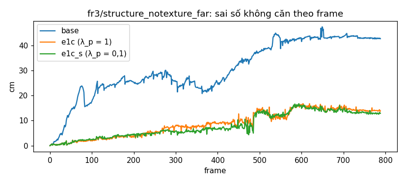
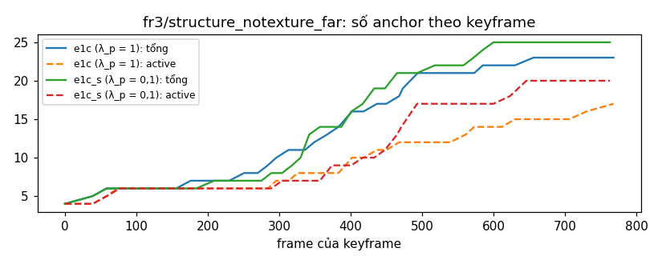
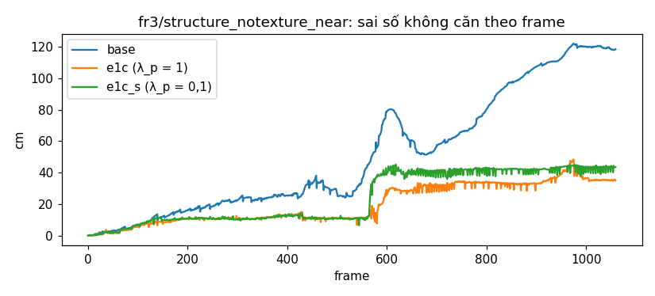
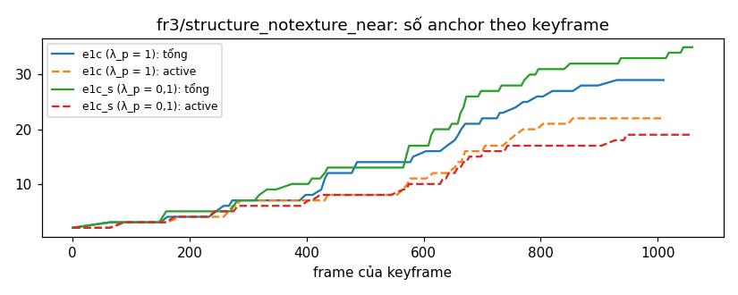

# REPORT MonoGS-E1c — tái lập MonoGS trên fr1/desk, E1c trên MonoGS (snt_far, snt_near)

Sinh từ dữ liệu (`tools/monogs/make_report.py --stage full`). Nhánh `exp/monogs-e1c`. 1 seed mỗi run.

## 1. Tóm tắt

- **Phần A:** sp_r1 ATE keyframe 1,43 cm, r = 0,95 so với paper 1,50 cm → **khớp**. mt_r1 (song song): 1,46 cm, r = 0,97. Chạy lại cùng seed: keyframe khác, ATE 1,43 / 1,54 cm, mức nhiễu 8,1 %.
- **fr3/structure_notexture_far, e1c (λ_p = 1), ATE keyframe:** 6,24 so với base 9,75 cm (-36,0 %) → **E1c tốt hơn base**.
- **fr3/structure_notexture_far, e1c (λ_p = 1), ATE mọi frame:** 5,66 so với base 10,55 cm (-46,3 %) → **E1c tốt hơn base**.
  - RPE Δ1 1,394 so với 0,801 cm → **giật hơn**.
- **fr3/structure_notexture_far, e1c_s (λ_p = 0,1), ATE keyframe:** 5,76 so với base 9,75 cm (-40,9 %) → **E1c tốt hơn base**.
- **fr3/structure_notexture_far, e1c_s (λ_p = 0,1), ATE mọi frame:** 5,45 so với base 10,55 cm (-48,3 %) → **E1c tốt hơn base**.
  - RPE Δ1 1,527 so với 0,801 cm → **giật hơn**.
- **fr3/structure_notexture_near, e1c (λ_p = 1), ATE keyframe:** 10,93 so với base 34,15 cm (-68,0 %) → **E1c tốt hơn base**.
- **fr3/structure_notexture_near, e1c (λ_p = 1), ATE mọi frame:** 13,30 so với base 40,36 cm (-67,1 %) → **E1c tốt hơn base**.
  - RPE Δ1 2,033 so với 1,369 cm → **giật hơn**.
- **fr3/structure_notexture_near, e1c_s (λ_p = 0,1), ATE keyframe:** 11,79 so với base 34,15 cm (-65,5 %) → **E1c tốt hơn base**.
- **fr3/structure_notexture_near, e1c_s (λ_p = 0,1), ATE mọi frame:** 13,97 so với base 40,36 cm (-65,4 %) → **E1c tốt hơn base**.
  - RPE Δ1 2,877 so với 1,369 cm → **giật hơn**.
- **"Tương tự 2DGS-SLAM" (e1c (λ_p = 1)):** giảm ATE mọi frame 46,3 % (snt_far) và 67,1 % (snt_near); cần ≥ 50 % trên cả hai → **không đạt** (2DGS-SLAM: −74 % / −84 %).
- **"Tương tự 2DGS-SLAM" (e1c_s (λ_p = 0,1)):** giảm ATE mọi frame 48,3 % (snt_far) và 65,4 % (snt_near); cần ≥ 50 % trên cả hai → **không đạt** (2DGS-SLAM: −74 % / −84 %).
- **fr3/structure_notexture_far, e1c_s so với e1c (ATE keyframe):** 5,76 so với 6,24 cm (-7,7 %) → trong nhiễu.
- **fr3/structure_notexture_near, e1c_s so với e1c (ATE keyframe):** 11,79 so với 10,93 cm (7,9 %) → trong nhiễu.

**Ba dòng kết luận:**
1. MonoGS (đơn luồng, đã seed) tái lập được paper trên fr1/desk: 1,43 cm so với 1,50 cm. Hai lần chạy cùng seed vẫn lệch vì `atomicAdd` của rasterizer (nhiễu ATE 8 %).
2. E1c giảm ATE keyframe của MonoGS 36–41 % trên snt_far và 65–68 % trên snt_near (vượt nhiễu), nhưng chưa đạt mức "tương tự 2DGS-SLAM": snt_far chỉ giảm 46–48 % ATE mọi frame, dưới ngưỡng 50 %.
3. E1c làm quỹ đạo giật hơn (RPE Δ1 tăng 1,5–2,1 lần). Hạ λ_p xuống 0,1 không đổi ATE (trong nhiễu) và không giảm độ giật.

## 2. Cài đặt

| Mục | Giá trị |
|---|---|
| GPU, driver, VRAM | NVIDIA GeForce RTX 5060 Ti, 591.86, 16311 MiB |
| CPU | AMD Ryzen 7 7700 8-Core Processor |
| CUDA toolkit | Cuda compilation tools, release 12.8, V12.8.93 |
| PyTorch / CUDA / cuDNN | 2.7.1+cu128 / 12.8 / 90701 |
| Open3D | 0.19.0 |
| NumPy | 1.23.5 |
| evo / matplotlib | 1.11.0 / 3.10.9 |
| Python | Python 3.10.21 |
| WSL kernel | 6.18.33.2-microsoft-standard-WSL2 |
| MonoGS | 6c9254c (muskie82/MonoGS, vendored unmodified in commit 749c5bd) |
| Submodule diff-gaussian-rasterization | 43e21bf |
| Submodule simple-knn | 44f7642 |
| TF32 mặc định (matmul / cuDNN) | False / True |

| Chuỗi | Đường dẫn | Dòng trong rgb.txt |
|---|---|---|
| rgbd_dataset_freiburg1_desk | `/home/wslphu/2DGS-SLAM/datasets/tum/rgbd_dataset_freiburg1_desk` | 613 |
| rgbd_dataset_freiburg3_structure_notexture_far | `/home/wslphu/2DGS-SLAM/datasets/tum/rgbd_dataset_freiburg3_structure_notexture_far` | 814 |
| rgbd_dataset_freiburg3_structure_notexture_near | `/home/wslphu/2DGS-SLAM/datasets/tum/rgbd_dataset_freiburg3_structure_notexture_near` | 1082 |

**Sửa build, tương thích và tái lập** (`git diff 749c5bd -- monogs/` liệt kê đúng các chỗ này):

| Sửa | Loại | Lý do |
|---|---|---|
| `submodules/simple-knn/simple_knn.cu`: thêm `#include <cfloat>` | Build | CUDA 12.8 báo `FLT_MAX` chưa khai báo (lần build đầu thất bại); cùng bản vá đã có trong 2DGS-SLAM |
| `utils/dataset.py`: `np.unicode_` → `np.str_` | Tương thích | NumPy ≥ 2 bỏ `np.unicode_` (env hiện có NumPy 1.23, sửa phòng xa như plan yêu cầu). Không đổi hành vi |
| `slam.py`: `from gui import slam_gui` chỉ khi `use_gui` | Tương thích | Chạy headless (slam_gui cần glfw / OpenGL). Không đổi hành vi |
| `utils/eval_utils.py`: bọc phần vẽ hình của `evaluate_evo` trong `try` | Tương thích | evo 1.11 `traj_colormap` lỗi với matplotlib 3.10 ("Unable to determine Axes to steal space for Colorbar"), làm crash `eval_ate` ở cuối run (smoke đầu tiên). ATE được tính trước bước vẽ, nên không đổi số |
| `utils/slam_backend.py`: đọc `Training.single_thread` (chỉ khi thiếu mới đọc `Dataset.single_thread`); log và so cờ ở cả hai tiến trình | Tái lập (§3.1) | Bản gốc: frontend đọc `Training`, backend đọc `Dataset` |
| `slam.py` / `utils/repro.py`: `--seed` (mặc định 0) seed `random`, `numpy`, `torch` (+ CUDA), `open3d.utility.random.seed`; `cudnn.deterministic = True`, `benchmark = False`; backend seed lại với `seed + 1` | Tái lập (§3.2) | Bản gốc không seed; Open3D `random_down_sample` và `torch.randperm` của backend ngẫu nhiên |
| `--save-dir`, `--range`, `--method`; ghi `traj_all.txt`, `traj_kf.txt`, `traj_gt_all.txt`, `kf_indices.txt`, `timing.json`, `ortho.csv` | CLI, chỉ ghi (§3.3) | |
| Frontend: đo ms tracking (có `torch.cuda.synchronize()` sau tracking), log cờ | Chỉ ghi | |
| Chạy với `WANDB_MODE=disabled` | Không gửi dữ liệu ra ngoài | |

Env `monogs` = clone của `2dgs-slam` (torch không đổi), cài thêm hai extension của MonoGS và các gói ở mục 2.2 của plan. Lệnh `pip install wandb` nâng `wandb` lên 0.31.0 và `protobuf` lên 7.36.2 trong env `monogs` (env `2dgs-slam` không bị đụng). Cài thêm `pypdf` để đọc paper (máy không có `pdftotext`).

## 3. Phần A

### Phần A — MonoGS trên fr1/desk

Số paper: **1,50 cm** (MonoGS, arXiv 2312.06741, Table 1, RGB-D, không loop closure; ATE RMSE trên keyframe, trung bình 3 run, chế độ song song, RTX 4090). Ở đây mỗi run là 1 lần chạy, RTX 5060 Ti.

| Run | Chế độ | ATE keyframe (cm) | ATE mọi frame (cm) | Số keyframe | Số frame | ms/frame tracking | s/frame tổng | r so với paper | Đánh giá |
|---|---|---|---|---|---|---|---|---|---|
| sp_r1 | đơn luồng, seed 0 | 1,43 | 1,43 | 109 | 592 | 525 | 2,52 | 0,95 | khớp |
| sp_r2 | đơn luồng, seed 0, chạy lại | 1,54 | 1,47 | 108 | 592 | 524 | 2,47 | 1,03 | khớp |
| mt_r1 | song song, seed 0 | 1,46 | 1,45 | 136 | 592 | 917 | 0,97 | 0,97 | khớp |

**sp_r1 so với sp_r2 (cùng code, cùng seed 0, chạy lại):**

| Chỉ số | Giá trị |
|---|---|
| Danh sách keyframe trùng nhau | không (109 / 108 keyframe, chung 30) |
| Lệch tâm camera lớn nhất ở keyframe chung, không căn (cm) | 0,729 |
| Lệch tâm camera lớn nhất trên mọi frame, không căn (cm) | 1,674 |
| Frame đầu tiên lệch > 1 mm | 1 |
| ATE keyframe r1 / r2 (cm) | 1,43 / 1,54 |
| ATE mọi frame r1 / r2 (cm) | 1,43 / 1,47 |
| Mức nhiễu tương đối n = \|ATE r1 − ATE r2\| / ATE r1 (keyframe) | 8,1 % |

**Tìm nguồn lệch còn lại (mục 4.2, 2 lần thử):**

1. **`torch.use_deterministic_algorithms(True, warn_only=True)`** (biến môi trường `MONOGS_DETERMINISTIC=1`, mặc định tắt), chạy lặp `--range 0 30` hai lần: hai run vẫn lệch ngay ở frame 1 (1,14 mm), và torch không báo cảnh báo thao tác bất định nào. Hai run không bật cờ cũng lệch như vậy (1,15 mm ở frame 1). Vậy nguồn lệch không nằm trong các op của PyTorch.
2. **Rà các lời gọi RNG** trong `monogs/` (RGB-D):
   - `torch.randperm` của backend đã được seed;
   - `random.randint` chỉ có trong tinh chỉnh màu, vốn không chạy;
   - `torch.randn_like` và `np.random.randn` chỉ có trong nhánh đơn mắt (monocular);
   - Open3D `random_down_sample` chạy trong backend, đã seed bằng `seed + 1`.
   Không còn RNG chưa seed.

**Kết luận:** nguồn còn lại là `atomicAdd` trong backward của rasterizer (12 chỗ trong `diff-gaussian-rasterization/cuda_rasterizer/backward.cu`). Thứ tự cộng số thực thay đổi giữa các lần chạy, nên ngay bản đồ khởi tạo (1 050 vòng mapping ở frame 0) đã khác, và frame 1 lệch khoảng 1 mm. Plan cho phép để nguyên, nên không sửa. Trên cả chuỗi, lệch nhỏ này làm danh sách keyframe tách ra (chỉ 30 keyframe trùng). ATE keyframe chênh 8,1 %, mức nhiễu n dùng ở phần B là max(8,1 %, 15 %) = 15 %.

**Code của các run phần A:** sp_r1 chạy ở `cf3148d` (trước khi port E1c); sp_r2 và mt_r1 chạy ở `19dc87f` (đã có hook E1c, tắt khi chạy base; đường chạy base giống hệt). Hai cây chỉ khác các file tool chưa commit, không đụng code chạy.

## 4. Test và smoke

### Test (mục 5.4)

| Test | Kết quả | Số liệu |
|---|---|---|
| T1 đổi pose | đạt | sai lớn nhất 0.0e+00 (100 pose ngẫu nhiên) |
| T2 quy ước gradient pose | đạt | bản đồ đã tối ưu (500 vòng, 75 % pixel opacity > 0,95): cos 0,997, dấu thành phần lớn trùng; δ = 10⁻³: cos 0,997. Chẩn đoán, bản đồ mới (opacity khoảng 0,5): cos -0,852 |
| T3 ManualAdam | đạt | sai tương đối lớn nhất 0.0e+00 so với torch.optim.Adam (200 bước) |
| T4 test E1c cũ | trượt (test_T3_solve_pose) | 9/10 đạt |

**T2.** Lần chạy đầu dựng bản đồ thẳng từ đám mây điểm của một frame (opacity khoảng 0,5) và cho cos −0,75. Chẩn đoán: với loss màu bỏ thừa số opacity, gradient rasterizer khớp sai phân trung tâm (cos 0,998), và các loss trơn (trung bình depth, trung bình màu có trọng số) khớp với cos 0,92–0,99 theo nhiễu trái `SE3_exp(τ) @ T_w2c`, không khớp theo nhiễu phải. Vậy quy ước τ của rasterizer trùng với loss plane. Phần lệch đến từ thừa số opacity trong loss tracking của MonoGS: rasterizer không đạo hàm theo nhánh opacity, mà nhánh đó lấn át khi opacity thấp. Test được sửa (1 lần) để đo ở trạng thái thật của hệ: bản đồ đã tối ưu như `initialize_map`.

**T4.** `test_T3_solve_pose` trượt **cả trên code gốc của nhánh `exp/e1c-decouple` trong env `2dgs-slam`** (cùng thông báo), nên không do việc port. `T3: clean worst 2.41e-06 deg / 6.35e-16 m; noisy rot median 0.470 max 0.806 deg, centre median 0.746 max 2.459 cm, trials over limit 7/20`. Ngưỡng của test (mọi thử nghiệm có nhiễu dưới 1° và 1 cm) chặt hơn mức nhiễu nó tự sinh; plan yêu cầu giữ nguyên logic E1c, nên không sửa.

### Smoke E1c (snt_far, `--range 0 200`, `--method e1c`)

| Chỉ số | Giá trị |
|---|---|
| Chạy hết | có (200 frame, 9 keyframe, 164 s) |
| NaN trong quỹ đạo | không |
| Nguồn khởi tạo | plane 140, prev 59, rejected 0 |
| ATE keyframe (cm) | 1.00 |
| ms/frame tracking / plane | 519 / 15.9 |

## 5. Phần B

### Phần B — E1c trên MonoGS

Mức nhiễu dùng để đọc kết quả: n = max(mức nhiễu phần A, 15 %) = **15,0 %**. "E1c tốt hơn base" khi ATE_e1c ≤ (1 − 2n) × ATE_base = 0,70 × ATE_base, xét trên ATE keyframe (chỉ số chính) và ghi thêm cho ATE mọi frame. "Không làm giật hơn" khi RPE Δ1 ≤ 1,1 × base. 1 seed.

#### fr3/structure_notexture_far

| Method | ATE keyframe (cm) | ATE mọi frame (cm) | RPE Δ1 (cm) | Sai số không căn cuối / lớn nhất (cm) | Keyframe | % khởi tạo bằng plane | % σ_min ≥ 0,3 | Anchor tổng / active | Cặp gần trùng | Đổi ID: bản trùng / nghi ghép sai | ms/frame tracking | ms/frame plane |
|---|---|---|---|---|---|---|---|---|---|---|---|---|
| base | 9,75 | 10,55 | 0,801 | 42,7 / 47,4 | 34 | — | — | — / — | — | — / — | 453 | — |
| e1c (λ_p = 1) | 6,24 | 5,66 | 1,394 | 13,9 / 16,8 | 41 | 53,8 | 53,8 | 23 / 17 | 36 | 404 / 293 | 555 | 18,0 |
| e1c_s (λ_p = 0,1) | 5,76 | 5,45 | 1,527 | 12,9 / 16,7 | 41 | 53,7 | 53,7 | 25 / 20 | 46 | 510 / 281 | 596 | 18,0 |

*Tham chiếu (khác giao thức):* 2DGS-SLAM (ATE mọi frame, bước 2, loop tắt, 1 seed): base 14,64, E1c 3,80 cm. Số công bố: MonoGS 16,63 (theo StructureGS), 10,39 (theo Spectral); StructureGS-SLAM 7,47 cm ("notex_far/near" trong các paper nhiều khả năng là structure_notexture_far/near).

#### fr3/structure_notexture_near

| Method | ATE keyframe (cm) | ATE mọi frame (cm) | RPE Δ1 (cm) | Sai số không căn cuối / lớn nhất (cm) | Keyframe | % khởi tạo bằng plane | % σ_min ≥ 0,3 | Anchor tổng / active | Cặp gần trùng | Đổi ID: bản trùng / nghi ghép sai | ms/frame tracking | ms/frame plane |
|---|---|---|---|---|---|---|---|---|---|---|---|---|
| base | 34,15 | 40,36 | 1,369 | 118,5 / 122,2 | 50 | — | — | — / — | — | — / — | 574 | — |
| e1c (λ_p = 1) | 10,93 | 13,30 | 2,033 | 35,2 / 48,4 | 84 | 36,3 | 36,3 | 29 / 22 | 18 | 312 / 175 | 646 | 16,5 |
| e1c_s (λ_p = 0,1) | 11,79 | 13,97 | 2,877 | 43,6 / 45,2 | 122 | 41,1 | 41,2 | 35 / 19 | 18 | 213 / 284 | 684 | 17,0 |

*Tham chiếu (khác giao thức):* 2DGS-SLAM (ATE mọi frame, bước 2, loop tắt, 1 seed): base 58,27, E1c 9,59 cm. Số công bố: MonoGS 55,59 (theo StructureGS), 26,91 (theo Spectral); StructureGS-SLAM 16,36 cm ("notex_far/near" trong các paper nhiều khả năng là structure_notexture_far/near).

## 6. Hình

## 7. Diễn giải

Theo quy tắc đặt trước ở mục 6.2 (n = 15 %, 1 seed):

1. **MonoGS tái lập được trên fr1/desk.** Đơn luồng 1,43 cm và song song 1,46 cm, so với 1,50 cm của paper, nên r xấp xỉ 1. Hai lần chạy cùng seed vẫn khác nhau vì `atomicAdd` của rasterizer, nhưng ATE chỉ chênh 8 %. Trên các chuỗi này, base MonoGS cho 10,55 cm (snt_far) và 40,36 cm (snt_near), ATE mọi frame. Các số đó nằm trong khoảng mà các paper khác công bố (10,39–16,63 và 26,91–55,59 cm).
2. **E1c giúp MonoGS rõ rệt, nhưng ít hơn trên 2DGS-SLAM.**
   - ATE keyframe giảm 36–41 % (snt_far) và 65–68 % (snt_near), vượt ngưỡng 2n = 30 % ở cả bốn trường hợp, nên đều xếp "E1c tốt hơn base".
   - Tiêu chí "tương tự 2DGS-SLAM" (giảm ATE mọi frame ≥ 50 % trên cả hai chuỗi) **không đạt**: snt_far chỉ giảm 46–48 %, trong khi trên 2DGS-SLAM là −74 % / −84 %.
   - Lưu ý: base MonoGS trên snt_far đã tốt hơn base 2DGS-SLAM (10,55 so với 14,64 cm), nên còn ít chỗ để cải thiện.
   - Theo ATE keyframe (giao thức của các paper), E1c trên MonoGS cho 6,24 cm (snt_far) và 10,93 cm (snt_near). StructureGS-SLAM công bố 7,47 và 16,36 cm. Đây chỉ là tham chiếu: khác máy, khác số run, và tên chuỗi trong các paper chưa chắc trùng.
3. **E1c làm quỹ đạo giật hơn.** RPE Δ1 tăng 1,7–1,9 lần (snt_far) và 1,5–2,1 lần (snt_near), vượt ngưỡng 1,1 lần. Bước pose của plane (khởi tạo dạng đóng ở khoảng 36–54 % frame, cộng gradient plane) đẩy pose theo từng frame. Trong khi đó, mapping và local BA của MonoGS chỉ chỉnh keyframe. E1c cũng làm tăng số keyframe trên snt_near (50 → 84–122).
4. **λ_p = 0,1 và λ_p = 1 cho kết quả trong nhiễu** (−7,7 % trên snt_far, +7,9 % trên snt_near), nên **không có bằng chứng** rằng trọng số plane đang quá lớn. e1c_s còn giật hơn e1c (RPE Δ1 cao hơn), nên độ giật không đến từ độ lớn λ_p. Nhiều khả năng nó đến từ khởi tạo dạng đóng và cách ghép anchor.
5. **Plane world chưa ổn định.** Cuối run có nhiều cặp anchor gần trùng (18–46) và hàng trăm lần đổi ID giữa hai frame liên tiếp. Đây là cùng kiểu lỗi đã thấy với E1c trên 2DGS-SLAM: anchor được trung bình hóa ở keyframe, không có gộp bản trùng.

## 8. Khác plan

1. **Worktree riêng** `~/2DGS-SLAM-monogs` thay cho `git checkout` trong `~/2DGS-SLAM`. Cây chính đang được một phiên khác dùng (nhánh `deform-v5-test`). Nhánh vẫn là `exp/monogs-e1c`, tạo từ `fork/exp/e1c-decouple` (c80ff00).
2. **Push lên remote `fork`** (github.com/BuiTienDunghe/2DGS-SLAM), như plan cho phép.
3. **Sửa build simple-knn** (`#include <cfloat>`): lần build đầu lỗi `FLT_MAX`; sửa 1 lần, đúng như mục 2.2 cho phép.
4. **Bọc phần vẽ hình của `evaluate_evo`** trong `try`: smoke đầu tiên crash ở cuối run vì evo 1.11 + matplotlib 3.10. Đây là sửa tương thích ngoài danh sách mục 2.3; nó không đổi số ATE.
5. **`pip install` mục 2.2 nâng `wandb` (0.31.0) và `protobuf` (7.36.2)** trong env `monogs`. Cài thêm `pypdf` để đọc paper, vì máy không có `pdftotext`. Env `2dgs-slam` không bị đụng.
6. **Số paper lấy từ bản arXiv tải được** (2312.06741, bản PDF hiện hành): Table 1, fr1/desk RGB-D = 1,50 cm. Paper ghi: ATE trên keyframe, trung bình 3 run, multi-process, RTX 4090.
7. **Cờ tất định để tìm nguồn lệch** (`MONOGS_DETERMINISTIC=1`, mặc định tắt) được thêm vào `utils/repro.py` cho lần thử 1 ở mục 4.2. Run chính không bật cờ này.
8. **sp_r1 chạy ở `cf3148d`, sp_r2 và mt_r1 ở `19dc87f`.** Hook E1c được commit khi sp_r1 đang chạy. Với `--method base`, hook không chạy, nên đường chạy base giống hệt.
9. **T2 sửa 1 lần:** bản đồ được tối ưu 500 vòng (như `initialize_map`) trước khi so gradient. Lý do: với bản đồ mới (opacity khoảng 0,5), loss tracking của MonoGS có thừa số opacity mà rasterizer không đạo hàm theo; chẩn đoán ghi ở TESTS.md.
10. **T4:** `test_T3_solve_pose` trượt ở cả nhánh nguồn trong env `2dgs-slam`; không sửa, vì plan yêu cầu giữ nguyên logic E1c.
11. **Ngoài hai nhãn "E1c tốt hơn base" / "trong nhiễu" của plan,** report thêm nhãn "tệ hơn base (ngoài nhiễu)" khi ATE_e1c > (1 + 2n) × ATE_base. Quy tắc "tốt hơn" được áp cho ATE keyframe (chỉ số chính) và ghi thêm cho ATE mọi frame.
12. **Đo ms tracking có thêm `torch.cuda.synchronize()`** sau mỗi lần tracking (chỉ để đo thời gian; tracking vốn đã đồng bộ ở `get_median_depth`).
13. **ID anchor trong `e1c_frames.jsonl`** là cặp ghép lúc tracking (trước khi ghép lại ở keyframe). Cặp gần trùng được tính trên tập anchor cuối run.
14. **Run cuối (snt_near / e1c_s) treo lúc thoát.** Run đã ghi đủ quỹ đạo và `timing.json` lúc 22:13, rồi không tự thoát (tiến trình backend không dừng). Tôi dừng tiến trình theo PID sau khoảng 5 phút, nên `runs.tsv` ghi rc = 143. Kết quả của run đầy đủ. Các run khác thoát bình thường.

