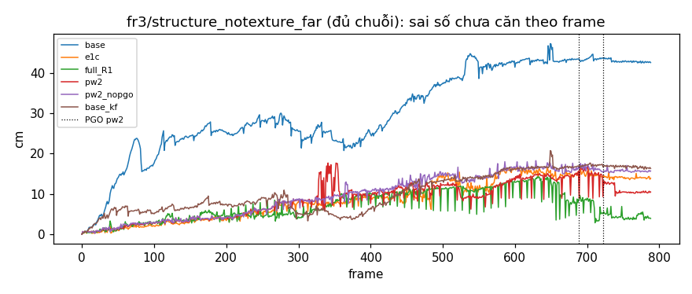
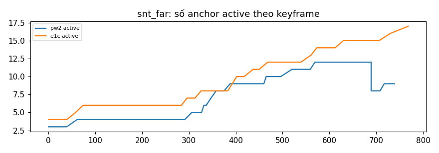
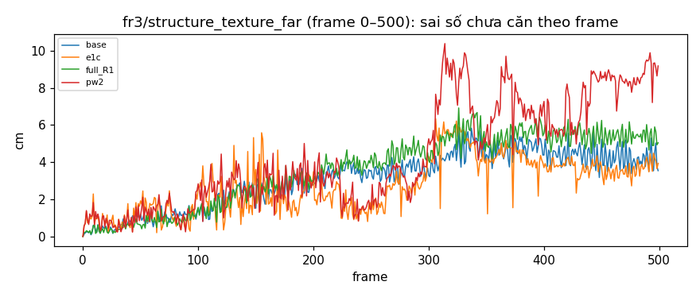
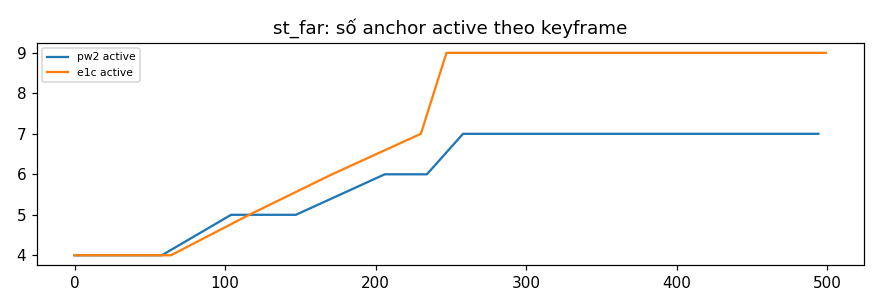
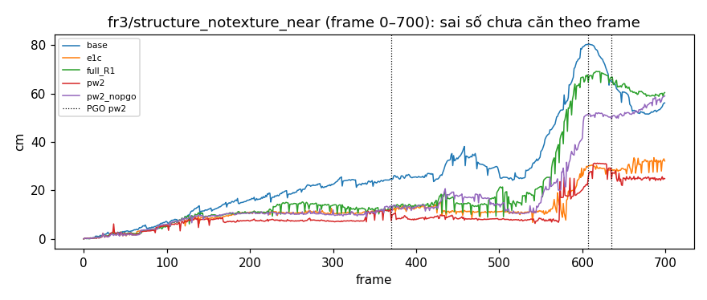
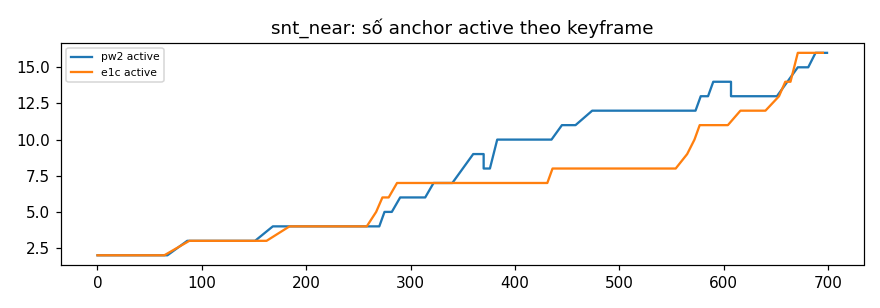

# REPORT MonoGS-PW2, lượt 2 (R2)

Sinh bằng `tools/monogs/pw2/make_report_pw2.py`. Nhánh `exp/monogs-pw2`. 1 seed (0); A **tốt hơn** B khi A ≤ 0,7·B, **tệ hơn** khi A ≥ 1,3·B. Run base / e1c của snt_far, snt_near lấy từ `results_monogs/B` (snt_near cắt về frame 0–700); st_far base / e1c và `full` (R1) lấy từ `results_monogs/PW`.

## 1. Kết luận lượt

**Kết luận (luật mục 8):** D1 không đạt → theo bảng mục 8: báo phân phối e của cặp đúng nhãn và nguyên nhân, không kết luận về D2–D4 (D1 trượt ở điều kiện nào: xem các dòng D1 bên dưới và phần diễn giải)

- **D1 (plane world sống lại?): KHÔNG ĐẠT** (cần trên mọi chuỗi đã chạy pw2)
  - snt_far: "đủ" 50,0 / E1c 53,8 %; cặp đúng nhãn bị loại 4,1 %; ghép nhầm 38,2 / E1c 37,3 %; bản trùng 2 / E1c 6 → không đạt.
  - st_far: "đủ" 58,7 / E1c 65,5 %; cặp đúng nhãn bị loại 4,0 %; ghép nhầm 29,8 / E1c 26,4 %; bản trùng 2 / E1c 1 → không đạt.
  - snt_near: "đủ" 49,8 / E1c 47,4 %; cặp đúng nhãn bị loại 2,6 %; ghép nhầm 25,2 / E1c 34,9 %; bản trùng 3 / E1c 6 → đạt.
- **D2 (hơn E1c?): KHÔNG ĐẠT**
  - snt_far: ATE keyframe 2,50 / E1c 6,24 cm → tốt hơn; ATE mọi frame (hiệu chỉnh) 3,45 / 5,66 cm → tốt hơn.
  - st_far: ATE keyframe 2,15 / E1c 1,16 cm → tệ hơn; ATE mọi frame (hiệu chỉnh) 3,14 / 1,98 cm → tệ hơn.
  - snt_near: ATE keyframe 6,78 / E1c 7,51 cm → trong nhiễu; ATE mọi frame (hiệu chỉnh) 6,53 / 7,48 cm → trong nhiễu.
- **D3 (PGO có ích?): KHÔNG ĐẠT**
  - snt_far: pw2 2,50 / pw2_nopgo 5,98 cm → tốt hơn; độ chính xác closure — %.
  - snt_near: pw2 6,78 / pw2_nopgo 18,96 cm → tốt hơn; độ chính xác closure — %.
- **D4 (lợi không chỉ do keyframe?): ĐẠT** — snt_far pw2 2,50 / base_kf 5,54 cm (51 keyframe) → tốt hơn.
- **D5 (giật, chỉ báo):**
  - snt_far: RPE Δ1 (hiệu chỉnh) pw2 1,587, e1c 1,394, base 0,801 cm.
  - st_far: RPE Δ1 (hiệu chỉnh) pw2 1,140, e1c 1,274, base 0,882 cm.
  - snt_near: RPE Δ1 (hiệu chỉnh) pw2 1,278, e1c 1,875, base 1,362 cm.

**Diễn giải (1 seed):**
1. **Plane world không còn "đói".** Sửa A (σ_eff) và B (`e_first`) có tác dụng đúng như chẩn đoán:
   - chỉ 2,6–4,1 % cặp đúng nhãn bị kernel loại (R1: 37–57 %);
   - "đủ" đạt 50–59 % frame, ngang E1c (47–66 %);
   - T1 chỉ sinh 0–9 keyframe (R1: 15–57).

   D1 trượt ở **ghép nhầm** (snt_far 38,2 so với E1c 37,3 %; st_far 29,8 so với 26,4 %) và **bản trùng** trên st_far (2 so với 1); trên snt_near thì đạt. Vì thế câu "plane world vẫn đói" của bảng mục 8 không đúng với dữ liệu, dù về mặt luật D1 không đạt. Lý do: σ_eff lớn hơn R1 khoảng 3 lần, nên kernel nhận lại cả cặp sai. Kiểm offline đã báo trước điều này: 35–55 % anchor sai nhãn trong cổng có e ≤ 3.
2. **Lợi trên snt đến từ đồ thị mặt phẳng, không đến từ closure.**
   - `pw2` hơn hẳn `pw2_nopgo`: 2,50 so với 5,98 cm (snt_far) và 6,78 so với 18,96 cm (snt_near).
   - **Không closure nào được nhận:** 5 ứng viên tier 2 đều sai nhãn, đều bị kiểm χ² bỏ đúng. Phần đóng góp nằm ở chỗ mỗi lần PGO tối ưu lại pose của mọi keyframe cùng mọi quan sát mặt phẳng, như một bước BA toàn cục bằng mặt phẳng.
   - Theo luật, D3 không đạt (độ chính xác closure không xác định).
   - Keyframe thêm **không** giải thích được lợi này: `base_kf` (51 keyframe) cho 5,54 cm, so với 2,50 cm của `pw2` (D4 đạt).
3. **st_far tệ hơn E1c** (2,15 so với 1,16 cm). Ở cảnh có texture, không có PGO nào chạy (không có ứng viên closure), và ghép nhầm tăng (29,8 %). Trên snt_near, `pw2` ngang E1c (6,78 so với 7,51 cm, trong nhiễu).
4. **Giật (D5):** RPE (hiệu chỉnh) của `pw2` thấp hơn E1c trên st_far và snt_near, cao hơn trên snt_far (1,59 so với 1,39). Ở cả ba chuỗi đều cao hơn base.

## 2. Hiệu chỉnh (chi tiết `pw2/CALIB_PW2.md`)

| Thang | σ_n | σ_d(z) |
|---|---|---|
| σ_pgo | 0,368° | 0,430 + 0,0958·z² cm |
| σ_eff | 0,830° | 0,411 + 0,4947·z² cm |
| R1 | 0,240° | 0,761 + 0,0042·z² cm |

σ_odo = 1,59 cm / 1,02°; θ_m = 2,78°, δ_m = 4,17 cm.

**Kiểm offline kernel** (σ_eff so với σ R1): snt_far_val: đúng nhãn có e ≤ 3: 75,8 % (R1 22,9 %), anchor sai nhãn trong cổng có e ≤ 3: 47,5 % (R1 14,8 %); st_far_val: đúng nhãn có e ≤ 3: 88,7 % (R1 20,9 %), anchor sai nhãn trong cổng có e ≤ 3: 54,6 % (R1 12,4 %); snt_near_val: đúng nhãn có e ≤ 3: 70,8 % (R1 34,6 %), anchor sai nhãn trong cổng có e ≤ 3: 34,8 % (R1 12,9 %).

## 3. κ theo tầm (chi tiết `pw2/KAPPA_HORIZON.md`)

Spearman giữa c_render và ε² âm ở mọi trục của cả hai chuỗi: trục render cứng hơn có sai số nhỏ hơn, đúng hướng giả định của 1b, nhưng tương quan yếu (−0,01 đến −0,38). Trung vị(ε_Δ²·c)/Δ **giảm** theo Δ trên st_far_val (sai số giữa hai frame liền nhau một phần là rung, triệt tiêu khi xa hơn), trong khi trên snt_far_val tăng ở trục tx và ry (trôi). Hai chuỗi lệch nhau khoảng 10–50 lần ở Δ = 1, khớp với việc κ không chuyển được giữa chúng ở R1. 1b vẫn tắt trong lượt này.

## 4. Test (chi tiết `pw2/TESTS_PW2.md`)

**Ghi chú test:**
- **T10 (a)** kiểm trên dữ liệu tổng hợp, không trên 10 frame thật. Khi không có cặp inlier, `DecoupledPoseStep` có cơ sở đơn vị và không hướng nào nhận gradient plane. Test so 100 bước với gradient ngẫu nhiên giữa bước đó và `torch.optim.Adam` (đường cập nhật của `base`): hai đường trùng nhau tuyệt đối. Kết luận áp được cho frame thật, vì đường cập nhật chỉ phụ thuộc gradient render.
- **T11 (b):** lần chạy đầu dùng seed drift khác với T4 của R1 (sai số giảm 5,8 → 3,9 cm, chưa tới 50 %). Đã sửa để chạy đúng bài toán T4 của R1 (seed 7), như plan yêu cầu.
- **T8:** lần chạy đầu lỗi import (thiếu đường dẫn `tools/monogs`); đã sửa.

## 5. Bảng mỗi chuỗi

### fr3/structure_notexture_far (đủ chuỗi)

| Method | ATE keyframe | ATE mọi frame (hiệu chỉnh*) | RPE Δ1 hiệu chỉnh* / thô | Chưa căn cuối / lớn nhất | Keyframe (mono/T1/T2) | "Đủ" % | % cặp bị kernel loại | % cặp đúng nhãn bị loại | Ứng viên tạo / xóa / kích hoạt | Anchor / mặt thật | Bản trùng | % ghép nhầm | Đổi ID đồng thời / lật | PGO áp | ms/frame | s tổng |
|---|---|---|---|---|---|---|---|---|---|---|---|---|---|---|---|---|---|
| base | 9,75 | 10,55* | 0,801* / 0,801 | 42,7 / 47,4 | 34 | — | — | — | — / — / — | — | — | — | — / — | — | 453 | 669 |
| e1c | 6,24 | 5,66* | 1,394* / 1,394 | 13,9 / 16,8 | 41 | 53,8 | — | — | — / — / — | 1,55 | 6 | 37,3 | 49 / 378 | — | 555 | 819 |
| full_R1 | 3,51 | 3,69 | 1,144 / 2,239 | 3,9 / 14,4 | 72 (8/57/6) | 8,8 | 58,7 | 38,7 | 218 / 189 / 4 | 1,00 | 0 | 15,8 | 0 / 23 | 5 | 688 | 1739 |
| pw2 | 2,50 | 3,45 | 1,587 / 2,403 | 10,5 / 17,7 | 49 (37/5/6) | 50,0 | 10,3 | 4,1 | 31 / 16 / 10 | 1,29 | 2 | 38,2 | 11 / 121 | 2 | 965 | 1436 |
| pw2_nopgo | 5,98 | 5,70 | 1,369 / 1,356 | 15,7 / 18,3 | 50 (42/7/0) | 51,0 | 9,5 | 3,0 | 28 / 15 / 10 | 1,30 | 3 | 37,9 | 9 / 139 | — | 980 | 1463 |
| base_kf | 5,54 | 5,48 | 0,547 / 0,657 | 16,3 / 20,8 | 51 | — | — | — | — / — / — | — | — | — | — / — | — | 489 | 891 |

\* run không có `traj_all_corr.txt` (run cũ, không PGO): dùng quỹ đạo thô.

### fr3/structure_texture_far (frame 0–500)

| Method | ATE keyframe | ATE mọi frame (hiệu chỉnh*) | RPE Δ1 hiệu chỉnh* / thô | Chưa căn cuối / lớn nhất | Keyframe (mono/T1/T2) | "Đủ" % | % cặp bị kernel loại | % cặp đúng nhãn bị loại | Ứng viên tạo / xóa / kích hoạt | Anchor / mặt thật | Bản trùng | % ghép nhầm | Đổi ID đồng thời / lật | PGO áp | ms/frame | s tổng |
|---|---|---|---|---|---|---|---|---|---|---|---|---|---|---|---|---|---|
| base | 1,36 | 1,43 | 0,878 / 0,882 | 3,5 / 5,8 | 15 | — | — | — | — / — / — | — | — | — | — / — | — | 490 | 372 |
| e1c | 1,16 | 1,98 | 1,272 / 1,274 | 3,9 / 6,3 | 15 | 65,5 | — | — | — / — / — | 1,12 | 1 | 26,4 | 30 / 107 | — | 574 | 410 |
| full_R1 | 1,78 | 2,02 | 0,916 / 0,917 | 5,0 / 6,9 | 23 (7/15/0) | 2,8 | 70,2 | 60,5 | 103 / 88 / 2 | 1,00 | 0 | 12,2 | 0 / 7 | — | 734 | 582 |
| pw2 | 2,15 | 3,14 | 1,140 / 1,145 | 9,2 / 10,4 | 14 (13/0/0) | 58,7 | 9,1 | 4,0 | 12 / 4 / 3 | 1,40 | 2 | 29,8 | 6 / 85 | — | 708 | 478 |

\* run không có `traj_all_corr.txt` (run cũ, không PGO): dùng quỹ đạo thô.

### fr3/structure_notexture_near (frame 0–700)

| Method | ATE keyframe | ATE mọi frame (hiệu chỉnh*) | RPE Δ1 hiệu chỉnh* / thô | Chưa căn cuối / lớn nhất | Keyframe (mono/T1/T2) | "Đủ" % | % cặp bị kernel loại | % cặp đúng nhãn bị loại | Ứng viên tạo / xóa / kích hoạt | Anchor / mặt thật | Bản trùng | % ghép nhầm | Đổi ID đồng thời / lật | PGO áp | ms/frame | s tổng |
|---|---|---|---|---|---|---|---|---|---|---|---|---|---|---|---|---|---|
| base | 26,36 | 24,85* | 1,362* / 1,362 | 56,1 / 80,4 | 42 | — | — | — | — / — / — | — | — | — | — / — | — | 574 | 1085 |
| e1c | 7,51 | 7,48* | 1,875* / 1,875 | 32,1 / 33,5 | 55 | 47,4 | — | — | — / — / — | 1,60 | 6 | 34,9 | 60 / 140 | — | 646 | 1544 |
| full_R1 | 27,01 | 23,84 | 1,717 / 3,100 | 60,4 / 69,1 | 74 (31/40/2) | 5,7 | 62,8 | 47,8 | 222 / 190 / 8 | 1,33 | 3 | 18,7 | 0 / 28 | 6 | 798 | 1597 |
| pw2 | 6,78 | 6,53 | 1,278 / 1,553 | 24,8 / 31,3 | 58 (43/9/5) | 49,8 | 12,6 | 2,6 | 53 / 33 / 16 | 1,23 | 3 | 25,2 | 0 / 93 | 3 | 664 | 1043 |
| pw2_nopgo | 18,96 | 17,56 | 1,781 / 1,716 | 59,0 / 59,0 | 67 (45/21/0) | 35,9 | 20,7 | 6,4 | 84 / 52 / 28 | 2,14 | 16 | 21,7 | 4 / 104 | — | 714 | 1171 |

\* run không có `traj_all_corr.txt` (run cũ, không PGO): dùng quỹ đạo thô.

## 6. Từng lần PGO

**snt_far / pw2** — độ chính xác closure (closure được nhận, có nhãn): — % (0)

| Frame k | Trạng thái | Tier 1 / tier 2 | Closure (anchor, tier, đúng nhãn, bị bỏ, w IRLS) | ATE tập keyframe trước → sau (cm) | Dịch lớn nhất (cm) | s |
|---|---|---|---|---|---|---|
| 689 | applied | 0 / 1 | a21 t2 sai BỎ w=0,12 | 5,72 → 3,36 | 7,97 | 0,6 |
| 722 | applied | 0 / 1 | a21 t2 sai BỎ w=0,08 | 3,59 → 2,47 | 6,84 | 0,7 |

**snt_near / pw2** — độ chính xác closure (closure được nhận, có nhãn): — % (0)

| Frame k | Trạng thái | Tier 1 / tier 2 | Closure (anchor, tier, đúng nhãn, bị bỏ, w IRLS) | ATE tập keyframe trước → sau (cm) | Dịch lớn nhất (cm) | s |
|---|---|---|---|---|---|---|
| 370 | applied | 0 / 1 | a15 t2 sai BỎ w=0,11 | 2,94 → 2,06 | 4,13 | 0,5 |
| 607 | applied | 0 / 1 | a2 t2 sai BỎ w=0,08 | 4,82 → 5,92 | 10,23 | 0,9 |
| 635 | applied | 0 / 1 | a31 t2 sai BỎ w=0,04 | 6,65 → 6,05 | 3,42 | 0,7 |

## 7. Gợi ý cho lượt sau

**Gợi ý (rút từ log; chưa thử):**
1. **Tách lợi của "BA mặt phẳng" khỏi closure.** Lợi lớn nhất của lượt này đến từ việc tối ưu lại đồ thị pose + mặt phẳng, không từ closure. Lượt sau nên chạy PGO định kỳ (`force_every_kf`), không cần closure, như một method riêng, và so với `pw2_nopgo` trên nhiều seed. Cũng là bước đầu của "plane trong local BA".
2. **Closure tier 2 hiện chỉ sinh ứng viên sai** (5/5). Cổng rộng 15° / 30 cm với điều kiện "đúng một anchor cũ" không phân biệt được mặt song song. Lượt sau có thể bỏ tier 2, hoặc chỉ nhận khi có ≥ 2 mặt không song song cùng khớp (gần với điều kiện của `sgs`).
3. **Ghép nhầm tăng lại khi σ_eff lớn.** Kiểm offline cho thấy 35–55 % anchor sai nhãn trong cổng qua kernel. Một σ_eff chung cho mọi khoảng cách frame quá rộng với cặp gần, quá hẹp với cặp xa (bảng theo khoảng cách frame trong `CALIB_PW2.md`). Hướng: σ_eff theo khoảng cách keyframe kể từ lúc tạo anchor (đo được trên validation, không phải mô hình drift).
4. **st_far:** không có closure nên không có PGO. Lợi của plane ở cảnh có texture vẫn chưa có; E1c vẫn tốt nhất (1,16 cm).
5. **Thời gian:** tracking của `pw2` chậm hơn E1c (660–965 so với 555 ms/frame), chủ yếu do đo độ cứng ở mỗi keyframe (12 render) và tính e cho mọi anchor qua cổng trong `e_first`.

- *snt_far, pw2, e theo độ sâu:* z 1-2: trung vị e 0,85, loại 7,7 % (2275 cặp); z 2-3: trung vị e 1,34, loại 14,6 % (1388 cặp)
- *st_far, pw2, e theo độ sâu:* z 1-2: trung vị e 0,24, loại 3,0 % (668 cặp); z 2-3: trung vị e 1,18, loại 11,4 % (1773 cặp); z 3-99: trung vị e 3,90, loại 100,0 % (1 cặp)
- *snt_near, pw2, e theo độ sâu:* z 0-1: trung vị e 0,37, loại 9,7 % (1347 cặp); z 1-2: trung vị e 0,84, loại 15,6 % (1389 cặp); z 2-3: trung vị e 2,05, loại 0,0 % (1 cặp)

## 8. Run bị bỏ

Không có.

Không bỏ run nào. N của `base_kf` = round(789 / 49) = 16 (789 frame, 49 keyframe của run 1); run có 51 keyframe. Run `snt_near/pw2` ghi đủ kết quả rồi treo lúc thoát (lỗi đã gặp ở các lượt trước); watchdog 10 phút dừng nó (rc = 143). Kết quả đầy đủ.

## 9. Khác plan

1. **Watchdog 10 phút** (`WATCHDOG_IDLE_S=600`) cho mọi run lượt này, thay vì 30 phút. Ở R1, một run treo lúc thoát làm mất 30 phút. Điều này an toàn vì PGO giờ chỉ mất dưới 1 giây.
2. **N của `base_kf`** tính từ số frame thật của run 1 (789) chia số keyframe (49), làm tròn: 16, đúng như plan.
3. **T10 (a)** kiểm trên gradient tổng hợp, không trên 10 frame thật (xem `TESTS_PW2.md`).
4. **σ_eff dùng một bộ (a, b) cho mọi khoảng cách frame,** đúng plan, dù bảng theo khoảng cách cho thấy phần dư tăng theo khoảng cách.
5. **Kết luận lượt:** D1 không đạt nên theo bảng mục 8 không kết luận về D2–D4. Report vẫn ghi số và luật của D2–D4 để tham khảo, cùng diễn giải vì sao D1 trượt (ghép nhầm, bản trùng; không phải thiếu cặp).
6. **Độ chính xác closure** không xác định (không closure nào được nhận) nên D3 không đạt theo luật, dù ATE `pw2` tốt hơn `pw2_nopgo` trên cả hai chuỗi snt.
7. **Run cũ** (base, e1c ở `results_monogs/B`) không có `traj_all_corr.txt`, nên ATE mọi frame và RPE của chúng tính trên quỹ đạo thô (đánh dấu * trong bảng), như plan cho phép.
8. **Hai lần chạy test bị lỗi của chính test** (T8 thiếu đường dẫn import, T11b dùng seed khác T4 R1) đã sửa 1 lần mỗi lỗi.

## Hình

