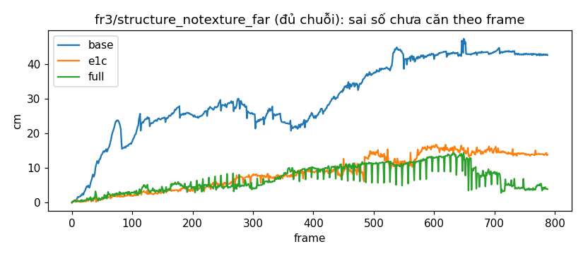
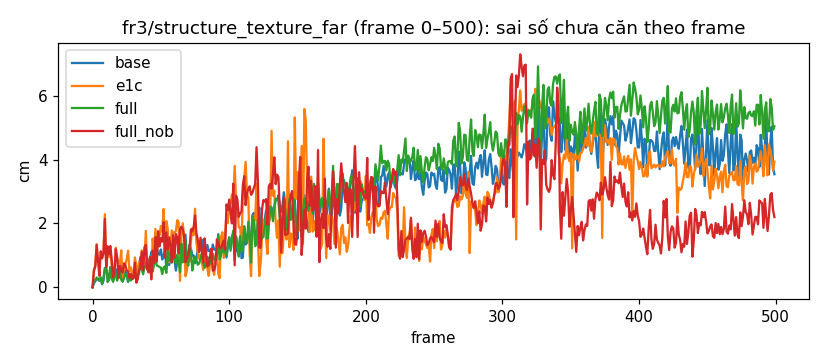
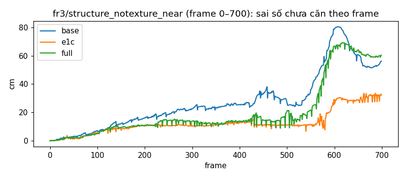

# REPORT MonoGS-PW, lượt 1 (R1)

Sinh bằng `tools/monogs/pw/make_report_pw.py`. Nhánh `exp/monogs-pw`. 1 seed (0) mỗi run; mức nhiễu n = 15 %: A **tốt hơn** B khi A ≤ 0,7·B, **tệ hơn** khi A ≥ 1,3·B, còn lại trong nhiễu. Run base và e1c của snt_far, snt_near lấy từ `results_monogs/B` (lượt MonoGS-E1c); snt_near được cắt về frame 0–700 (`--max-frame`). Với run đủ chuỗi bị cắt, khoảng 3 keyframe cuối trước frame cắt có thể còn được local BA chỉnh sau đó.

## 1. Trả lời ngắn (theo mục 9)

- **Run 1 (fr3/structure_notexture_far (đủ chuỗi)):** ATE keyframe `full` 3,51 cm, `e1c` 6,24 cm, `base` 9,75 cm → full so với e1c: **tốt hơn**. Plane world ổn định hơn E1c (8.6): **không** (cặp gần trùng 1 / 36, đổi ID 9 / 697, "đủ" 8,8 / 53,8 %). Closure: tier 1 0, tier 2 14; PGO áp 5, hủy 0.
- **Run 6 (fr3/structure_notexture_near (frame 0–700)):** ATE keyframe `full` 27,01 cm, `e1c` 7,51 cm, `base` 26,36 cm → full so với e1c: **tệ hơn**. Plane world ổn định hơn E1c (8.6): **không** (cặp gần trùng 4 / 10, đổi ID 3 / 232, "đủ" 5,7 / 47,4 %). Closure: tier 1 0, tier 2 8; PGO áp 6, hủy 0.
- **Run 2–4 (st_far 0–500):** ATE keyframe full 1,78, e1c 1,16, base 1,36 cm → full so với e1c: **tệ hơn**; RPE Δ1 full 0,917, e1c 1,274, base 0,882 cm → full không giật hơn base (ngưỡng 1,1×).
- **Run 5 (1b giảm giật?):** RPE Δ1 full 0,917, full_nob 1,369, base 0,882 cm → **có** (quy tắc: full ≤ 0,7 × full_nob, hoặc full ≤ 1,1 × base trong khi full_nob > 1,1 × base). ATE keyframe full_nob 1,05 cm.
- **Method mới hơn E1c (lượt này):** snt_far: tốt hơn, st_far: tệ hơn, snt_near: tệ hơn → **không đạt** (cần tốt hơn ở ≥ 1 chuỗi và không tệ hơn ở chuỗi nào).
- **Phần chia đúng hướng:** trung vị s_k (trục plane quan sát được, tại keyframe) snt: 0,070, 0,124; st_far: 0,003 → **đúng** (cần snt > st_far).
- **Kernel bền có ích (snt_far, nhãn GT):** sai nhãn trong cặp được nhận 15,8 %, trong mọi cặp ứng viên 43,3 %, trong cặp bị loại 62,7 % → **có** (cần ≤ 0,5×).
  - Không trôi ngoài PGO (snt_far): trung vị 0,067° / 0,000 cm → **đạt**.
- **Kernel bền có ích (st_far, nhãn GT):** sai nhãn trong cặp được nhận 12,2 %, trong mọi cặp ứng viên 33,8 %, trong cặp bị loại 42,9 % → **có** (cần ≤ 0,5×).
  - Không trôi ngoài PGO (st_far): trung vị 0,000° / 0,000 cm → **đạt**.
- **Kernel bền có ích (snt_near, nhãn GT):** sai nhãn trong cặp được nhận 18,7 %, trong mọi cặp ứng viên 42,0 %, trong cặp bị loại 55,8 % → **có** (cần ≤ 0,5×).
  - Không trôi ngoài PGO (snt_near): trung vị 0,105° / 0,439 cm → **đạt**.

**Kết luận lượt 1 (1 seed):**
1. **`full` chưa hơn E1c.** Tốt hơn trên snt_far (3,51 so với 6,24 cm), nhưng tệ hơn trên st_far (1,78 so với 1,16 cm) và snt_near 0–700 (27,0 so với 7,5 cm; gần bằng base 26,4 cm).
2. **Plane world sạch hơn, nhưng gần như không còn cặp để dùng.** Bản trùng và đổi ID giảm mạnh, ghép nhầm giảm khoảng một nửa (theo nhãn GT). Đổi lại, kernel loại 56–70 % cặp ứng viên, và hơn một nửa số cặp bị loại là cặp đúng. Ứng viên rất ít khi được kích hoạt, nên "đủ" chỉ còn 3–9 % frame (E1c: 47–66 %). Nguyên nhân: mô hình nhiễu chỉ có nhiễu đo (đo bằng pose GT, σ_n = 0,24°, σ_d ≈ 0,76 cm), trong khi sai số pose tracking giữa keyframe tạo anchor và frame hiện tại cỡ vài cm. Cặp đúng vì vậy cũng có e = 3–5.
3. **1b giảm giật trên st_far:** RPE của `full` là 0,92 cm, gần base 0,88; `full_nob` là 1,37. Phần chia s_k theo đúng hướng (snt > st). Nhưng κ không chuyển được giữa hai chuỗi validation (chênh hơn 40 lần). Trên snt, `full` giật hơn base 2–3 lần, phần lớn do khởi tạo dạng đóng, nhiều keyframe T1 và các lần PGO dời pose.

## 2. Hiệu chỉnh (mục 4, chi tiết ở `pw/CALIB_PW.md`)

| Đại lượng | Giá trị |
|---|---|
| σ_n | 0,240° |
| σ_d(z) | 0,761 + 0,0042·z² cm |
| θ_m / δ_m | 2,51° / 3,92 cm |
| σ_odo | 3,96 cm / 0,77° |
| κ chung (dịch / quay) | 2915,7 (3152,0 / 2865,7) |
| κ snt_far_val (dịch / quay) | 22911,2 (26533,7 / 20115,1) |
| κ st_far_val (dịch / quay) | 515,6 (566,6 / 448,6) |

κ của hai chuỗi validation chênh nhau hơn 40 lần (ngưỡng ghi nhận của plan là 3 lần). Theo plan, giữ một số chung, không đổi.

## 3. Test

Xem `pw/TESTS_PW.md`: T1, T2, T3, T4, T6, T7 đạt; T5 trượt (2 mặt không xác định được dịch dọc giao tuyến).

## 4. Bảng mỗi chuỗi (mục 8.6)

### fr3/structure_notexture_far (đủ chuỗi)

| Method | ATE keyframe | ATE mọi frame | ATE mọi frame hiệu chỉnh | RPE Δ1 | Sai số chưa căn cuối / lớn nhất | Keyframe (mono/T1/T2) | ms/frame tracking | ms/frame plane | s tổng |
|---|---|---|---|---|---|---|---|---|---|
| base | 9,75 | 10,55 | — | 0,801 | 42,7 / 47,4 | 34 | 453 | — | 669 |
| e1c | 6,24 | 5,66 | — | 1,394 | 13,9 / 16,8 | 41 | 555 | 18,0 | 819 |
| full | 3,51 | 4,35 | 3,69 | 2,239 | 3,9 / 14,4 | 72 (8/57/6) | 688 | 16,9 | 1739 |

| Method | Anchor tổng / active cuối | Cặp gần trùng | Đổi ID (bản trùng / nghi ghép sai) | % khởi tạo bằng plane | "Đủ" (%) | % cặp bị kernel loại | w TB | Cặp bị bỏ ở khởi tạo bền | Ứng viên tạo / xóa / kích hoạt | Gộp | ms đo độ cứng |
|---|---|---|---|---|---|---|---|---|---|---|---|
| e1c | 23 / 17 | 36 | 404 / 293 | 53,8 | 53,8 | — | — | — | — / — / — | — | — |
| full | 9 / 8 | 1 | 5 / 4 | 20,6 | 8,8 | 58,7 | 0,280 | 1084 | 218 / 189 / 4 | 20 | 61 |

*full: e theo độ sâu:* z 1-2: trung vị e 3,38, loại 53,0 % (2268 cặp); z 2-3: trung vị e 7,27, loại 68,1 % (1389 cặp)

### fr3/structure_texture_far (frame 0–500)

| Method | ATE keyframe | ATE mọi frame | ATE mọi frame hiệu chỉnh | RPE Δ1 | Sai số chưa căn cuối / lớn nhất | Keyframe (mono/T1/T2) | ms/frame tracking | ms/frame plane | s tổng |
|---|---|---|---|---|---|---|---|---|---|
| base | 1,36 | 1,41 | 1,43 | 0,882 | 3,5 / 5,8 | 15 | 490 | — | 372 |
| e1c | 1,16 | 1,92 | 1,98 | 1,274 | 3,9 / 6,3 | 15 | 574 | 16,7 | 410 |
| full | 1,78 | 1,96 | 2,02 | 0,917 | 5,0 / 6,9 | 23 (7/15/0) | 734 | 16,4 | 582 |
| full_nob | 1,05 | 1,72 | 1,68 | 1,369 | 2,2 / 7,3 | 28 (7/20/0) | 645 | 17,1 | 600 |

| Method | Anchor tổng / active cuối | Cặp gần trùng | Đổi ID (bản trùng / nghi ghép sai) | % khởi tạo bằng plane | "Đủ" (%) | % cặp bị kernel loại | w TB | Cặp bị bỏ ở khởi tạo bền | Ứng viên tạo / xóa / kích hoạt | Gộp | ms đo độ cứng |
|---|---|---|---|---|---|---|---|---|---|---|---|
| e1c | 11 / 9 | 2 | 22 / 114 | 65,5 | 65,5 | — | — | — | — / — / — | — | — |
| full | 15 / 6 | 15 | 2 / 0 | 8,2 | 2,8 | 70,2 | 0,208 | 933 | 103 / 88 / 2 | 0 | 63 |
| full_nob | 14 / 6 | 13 | 1 / 0 | 14,4 | 14,8 | 56,3 | 0,378 | 1080 | 100 / 86 / 2 | 0 | 63 |

*full: e theo độ sâu:* z 1-2: trung vị e 2,89, loại 47,9 % (668 cặp); z 2-3: trung vị e 6,55, loại 78,5 % (1808 cặp); z 3-99: trung vị e 12,09, loại 100,0 % (1 cặp)

*full_nob: e theo độ sâu:* z 1-2: trung vị e 0,36, loại 14,8 % (668 cặp); z 2-3: trung vị e 6,31, loại 71,8 % (1775 cặp); z 3-99: trung vị e 14,13, loại 100,0 % (1 cặp)

### fr3/structure_notexture_near (frame 0–700)

| Method | ATE keyframe | ATE mọi frame | ATE mọi frame hiệu chỉnh | RPE Δ1 | Sai số chưa căn cuối / lớn nhất | Keyframe (mono/T1/T2) | ms/frame tracking | ms/frame plane | s tổng |
|---|---|---|---|---|---|---|---|---|---|
| base | 26,36 | 24,85 | — | 1,362 | 56,1 / 80,4 | 42 | 574 | — | 1085 |
| e1c | 7,51 | 7,48 | — | 1,875 | 32,1 / 33,5 | 55 | 646 | 16,5 | 1544 |
| full | 27,01 | 24,72 | 23,84 | 3,100 | 60,4 / 69,1 | 74 (31/40/2) | 798 | 14,1 | 1597 |

| Method | Anchor tổng / active cuối | Cặp gần trùng | Đổi ID (bản trùng / nghi ghép sai) | % khởi tạo bằng plane | "Đủ" (%) | % cặp bị kernel loại | w TB | Cặp bị bỏ ở khởi tạo bền | Ứng viên tạo / xóa / kích hoạt | Gộp | ms đo độ cứng |
|---|---|---|---|---|---|---|---|---|---|---|---|
| e1c | 21 / 16 | 10 | 121 / 111 | 47,4 | 47,4 | — | — | — | — / — / — | — | — |
| full | 17 / 12 | 4 | 3 / 0 | 7,7 | 5,7 | 62,8 | 0,296 | 608 | 222 / 190 / 8 | 15 | 65 |

*full: e theo độ sâu:* z 0-1: trung vị e 7,74, loại 67,7 % (1338 cặp); z 1-2: trung vị e 4,04, loại 57,9 % (1371 cặp); z 2-3: trung vị e 6,31, loại 100,0 % (1 cặp)

## 5. 1b (mục 8.5)

Trung vị (phân vị 25–75 %) tại keyframe; s_k chỉ ở trục có c_plane > 0.

| Chuỗi / method | c_render tx | c_render ty | c_render tz | c_render rx | c_render ry | c_render rz | s_k tx | s_k ty | s_k tz | s_k rx | s_k ry | s_k rz | RPE Δ1 |
|---|---|---|---|---|---|---|---|---|---|---|---|---|---|
| snt_far / full | 21 (12–28) | 20 (15–23) | 8 (6–10) | 52 (45–60) | 73 (45–88) | 15 (9–20) | 0,006 (0,000–0,036) | 0,077 (0,052–0,115) | 0,042 (0,022–0,131) | 0,075 (0,041–0,109) | 0,023 (0,008–0,054) | 0,259 (0,172–0,403) | 2,239 |
| st_far / full_nob | 115 (78–141) | 81 (43–122) | 15 (10–21) | 353 (269–416) | 357 (287–407) | 78 (57–96) | 0,003 (0,002–0,014) | 0,044 (0,030–0,077) | 0,040 (0,027–0,144) | 0,025 (0,019–0,035) | 0,004 (0,002–0,017) | 0,103 (0,075–0,120) | 1,369 |
| st_far / full | 267 (234–305) | 309 (273–355) | 59 (48–75) | 775 (704–841) | 698 (620–768) | 262 (196–291) | 0,001 (0,001–0,001) | 0,006 (0,006–0,006) | 0,023 (0,016–0,030) | 0,003 (0,001–0,004) | 0,001 (0,001–0,003) | 0,006 (0,003–0,014) | 0,917 |
| snt_near / full | 18 (11–23) | 27 (18–31) | 7 (3–8) | 31 (19–39) | 24 (12–31) | 5 (3–8) | 0,035 (0,013–0,061) | 0,059 (0,031–0,093) | 0,221 (0,107–0,306) | 0,148 (0,030–0,208) | 0,132 (0,026–0,244) | 0,393 (0,169–0,581) | 3,100 |

## 6. Gợi ý điều chỉnh (rút từ log)

- **snt_far:** kernel loại 58,7 % cặp ứng viên active; T1 sinh 57 keyframe, T2 6; ứng viên tạo 218, xóa 189, kích hoạt 4; trung vị s_k 0,070. Ba frame giật nhất: frame 662: RPE 10,30 cm, khởi tạo `prev`, kernel loại 4 cặp, 1 cặp active, keyframe có (T2); frame 648: RPE 10,16 cm, khởi tạo `prev`, kernel loại 4 cặp, 1 cặp active, keyframe không; frame 657: RPE 9,48 cm, khởi tạo `prev`, kernel loại 3 cặp, 2 cặp active, keyframe có (T1).
- **st_far:** kernel loại 70,2 % cặp ứng viên active; T1 sinh 15 keyframe, T2 0; ứng viên tạo 103, xóa 88, kích hoạt 2; trung vị s_k 0,003. Ba frame giật nhất: frame 446: RPE 2,76 cm, khởi tạo `rejected`, kernel loại 5 cặp, 0 cặp active, keyframe không; frame 473: RPE 2,44 cm, khởi tạo `rejected`, kernel loại 4 cặp, 1 cặp active, keyframe không; frame 346: RPE 2,21 cm, khởi tạo `rejected`, kernel loại 5 cặp, 0 cặp active, keyframe có (mono).
- **snt_near:** kernel loại 62,8 % cặp ứng viên active; T1 sinh 40 keyframe, T2 2; ứng viên tạo 222, xóa 190, kích hoạt 8; trung vị s_k 0,124. Ba frame giật nhất: frame 583: RPE 19,94 cm, khởi tạo `prev`, kernel loại 2 cặp, 0 cặp active, keyframe không; frame 582: RPE 19,56 cm, khởi tạo `prev`, kernel loại 2 cặp, 0 cặp active, keyframe có (mono); frame 578: RPE 17,58 cm, khởi tạo `prev`, kernel loại 4 cặp, 0 cặp active, keyframe không.

**Gợi ý cho lượt sau** (rút từ log; chưa thử, không chỉnh trong lượt này):
1. **Thang của kernel và inlier phải gồm sai số pose tương đối, không chỉ nhiễu đo.** Cặp đúng có e trung vị khoảng 1,4–3, cộng một đuôi 3–5 ở mọi khoảng độ sâu. Cách đơn giản nhất mà vẫn đo được: hiệu chỉnh σ_n, σ_d bằng **pose ước lượng** của một run `full_nopgo` trên validation, đúng như plan đã định cho σ_odo. Kết quả sẽ là một bộ σ "hiệu dụng" lớn hơn.
2. **T1 sinh quá nhiều keyframe** (57 trên snt_far, 15–20 trên st_far): do mặt lớn không có cặp inlier active, mà nguyên nhân lại chính là gợi ý 1. Sửa gợi ý 1 trước rồi đo lại T1.
3. **Ứng viên tạo / xóa quá nhiều** (snt_far: 218 tạo, 189 xóa, 4 kích hoạt). Cũng là hệ quả của gợi ý 1.
4. **κ:** hai chuỗi validation chênh hơn 40 lần, nên một κ chung không đúng ở cả hai. Muốn giữ 1b thì cần κ theo cảnh, ví dụ ước lượng κ khi chạy từ độ cứng render, hoặc đơn vị thông tin khác cho render. Phần này cần thiết kế lại, không phải chỉnh số.
5. **PGO chậm:** trung bình khoảng 95 s mỗi lần trên snt_far, vì scipy dựng lại toàn bộ đồ thị với Jacobian sai phân. Nên dùng Jacobian giải tích hoặc GTSAM `CustomFactor`, và giới hạn đồ thị (ví dụ chỉ keyframe có quan sát mặt phẳng).
6. **Giật trên snt:** các frame giật nhất của `full` thường là frame khởi tạo bằng plane khi chỉ còn ít cặp active, hoặc frame ngay sau PGO. Trên E1c, frame có lật ID giật gấp 1,8–2,9 lần (DIAG_E1C).

## 7. Chỉ số theo nhãn GT (mục 8.2)

| Chuỗi / method | Mặt thật | Anchor / mặt thật | Bản trùng | % ghép nhầm | Kernel: % bị loại / sai nhãn trong bị loại / trong được nhận | Đổi ID đồng thời / lật | Thay đổi ngoài PGO: trung vị (lớn nhất) |
|---|---|---|---|---|---|---|---|
| snt_far / e1c | 89 | 1,55 | 6 | 37,3 | — | 49 / 378 | 0,809° / 1,350 cm (2,72° / 6,40 cm) |
| snt_far / full | 86 | 1,00 | 0 | 15,8 | 58,7 / 62,7 / 15,8 | 0 / 23 | 0,067° / 0,000 cm (0,52° / 0,66 cm) |
| st_far / e1c | 59 | 1,12 | 1 | 26,4 | — | 30 / 107 | 0,640° / 1,403 cm (2,52° / 4,71 cm) |
| st_far / full | 59 | 1,00 | 0 | 12,2 | 70,2 / 42,9 / 12,2 | 0 / 7 | 0,000° / 0,000 cm (0,06° / 0,12 cm) |
| st_far / full_nob | 59 | 1,00 | 0 | 7,8 | 56,3 / 60,8 / 7,8 | 0 / 1 | 0,000° / 0,000 cm (0,16° / 0,41 cm) |
| snt_near / e1c | 68 | 1,60 | 6 | 34,9 | — | 60 / 140 | 0,997° / 1,235 cm (5,95° / 16,32 cm) |
| snt_near / full | 54 | 1,33 | 3 | 18,7 | 62,8 / 55,8 / 18,7 | 0 / 28 | 0,105° / 0,439 cm (1,61° / 4,04 cm) |

## 8. Chẩn đoán E1c (mục 5)

Sinh bằng `tools/monogs/pw/diag_e1c.py` trên `results_monogs/B/{snt_far,snt_near}/e1c`. Mặt đo đổi về hệ camera bằng `traj_all`, rồi sang world bằng GT; nhãn mặt thật theo mục 8.1. Chỉ để diễn giải, không đổi thiết kế.

| Chuỗi | Anchor mới (sau keyframe đầu) | R1: mảnh khác cùng frame | R2: trong cổng, không ghép (overlap) | R3: ngoài cổng (trôi) | Mới thật | % ghép nhầm | Đổi ID đồng thời | Đổi ID lật |
|---|---|---|---|---|---|---|---|---|
| snt_far | 19 | 4 | 4 | 0 | 11 | 37,3 | 49 | 378 |
| snt_near | 27 | 1 | 4 | 2 | 20 | 34,2 | 96 | 261 |

**RPE (dịch, cm/frame) ở frame có và không có sự kiện:**

| Chuỗi | Có lật ID | Không lật ID | Số frame lật | Khởi tạo bằng plane | Không khởi tạo bằng plane | Số frame plane |
|---|---|---|---|---|---|---|
| snt_far | 1,17 | 0,66 | 307 | 0,80 | 0,92 | 424 |
| snt_near | 2,38 | 0,81 | 204 | 1,21 | 1,06 | 384 |

## 9. Phần 4: closure và PGO

| Chuỗi | Ứng viên tier 1 / tier 2 | PGO áp / hủy / bỏ qua | Factor bị bỏ | Closure được nhận | ms mỗi PGO | Dịch keyframe lớn nhất (cm) |
|---|---|---|---|---|---|---|
| snt_far / full | 0 / 14 | 5 / 0 / 0 | 4 | 5 | 94760 | 7,70 |
| st_far / full | 0 / 0 | 0 / 0 / 0 | 0 | 0 | — | 0 |
| st_far / full_nob | 0 / 0 | 0 / 0 / 0 | 0 | 0 | — | 0 |
| snt_near / full | 0 / 8 | 6 / 0 / 0 | 0 | 6 | 51596 | 18,00 |

Smoke ép PGO và test T3–T6: xem `pw/TESTS_PW.md`.

## 10. Run bị bỏ

Không có.

## 11. Khác plan

1. **Bỏ hạn chót 21:00 của mục 0.1.** Lượt này bắt đầu lúc 18:25, nên lịch 17:00–21:00 không còn áp được. Người dùng chọn chạy đủ, không cắt run. Không bỏ run nào vì hết giờ.
2. **PGO dùng `scipy.optimize.least_squares`, không dùng GTSAM.** Bản GTSAM trong env không có `OrientedPlane3Factor`. `CustomFactor` cần tự viết Jacobian cho một kiểu landmark mặt phẳng. Plan cho phép đường dự phòng này (mục 6). Cài đặt:
   - pose trái `T_w2c = Exp(ξ)·T0`, keyframe đầu cố định (thay prior σ = 1e-6);
   - mặt phẳng `n = normalize(n0 + B·δθ)`, `d = d0 + δd`;
   - Huber `f_scale = 1,345` áp trên **từng thành phần** phần dư đã chia σ (`loss='huber'` của scipy), không phải trên chuẩn của cả factor;
   - phần dư mặt phẳng 4 chiều [m − R·n_w (3); d] chia [σ_n, σ_n, σ_n, σ_d(z)], đúng phần dư E1c ở mục 2.1, thay cho 3 chiều của `OrientedPlane3Factor`.
3. **Giới hạn số lần đánh giá của solver:** `max_nfev = 100 × max(1, số biến / 50)`. Khi chạm giới hạn (status 0), coi là đã dừng theo giới hạn vòng của plan, không coi là lỗi. T4c lúc đầu bị hủy vì lý do này.
4. **κ không chuyển được giữa hai chuỗi validation** (22 911 so với 516, hơn 40 lần). Theo plan, vẫn dùng một κ chung (2 916) và không đổi số.
5. **σ_odo lấy từ hai run base hiệu chỉnh** (frame 0–300), đúng như phương án "lượt này" của plan: 3,96 cm / 0,77°.
6. **Mô hình nhiễu chỉ gồm nhiễu đo** (đo bằng pose GT): σ_n = 0,24°, σ_d ≈ 0,76 cm. Plan cố ý không dùng mô hình drift. Hệ quả quan sát được trên smoke và run: phần dư của các cặp **đúng** do sai số pose tracking thường ở e = 3–5, nên kernel loại cả nhiều cặp đúng, và ứng viên ít khi được kích hoạt. Không chỉnh theo chuỗi thử; xem mục 6 (gợi ý).
7. **Nhãn mặt thật dùng chung cho mọi run** (mục 8.1), gom theo thứ tự frame trên các mặt đo đã đổi sang world bằng GT. Với E1c, mặt đo trong log ở world ước lượng, nên được đổi về camera bằng `traj_all` trước.
8. **Đổi ID theo nhãn GT** (mục 8.2) đếm trên cặp được ghi sổ (E1c: mọi cặp ghép; PW: cặp inlier). Bảng 8.6 dùng `eval_runs.py` không sửa logic, chỉ thêm `--max-frame`.
9. **Hai cờ CLI chỉ dùng cho hiệu chỉnh và smoke:** `--stiffness-every N` (đo độ cứng mỗi N frame) và `--pgo-force-every N` (ép PGO mỗi N keyframe, smoke 2). Mặc định cả hai tắt.
10. **T6 (b):** ngưỡng 1 mm áp trên pixel hợp lệ theo quy ước MonoGS (opacity > 0,95 ở cả hai lần render). Số trên mọi pixel có depth vẫn được ghi kèm.
11. **sgs:** khi có đúng 2 mặt không song song, dịch dọc giao tuyến không xác định được (T5). Không thêm ràng buộc nào ngoài plan. Lượt này không chạy run `sgs` (không có trong bảng 7.3).
12. **Ghi `traj_all_corr.txt` cho mọi method** chạy ở lượt này. Các run cũ ở `results_monogs/B` không có file này, nên cột "ATE mọi frame hiệu chỉnh" của chúng để trống.

## Hình

