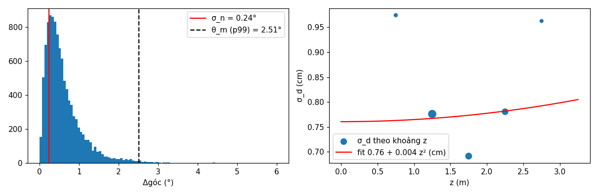

# CALIB_PW — hiệu chỉnh một lần (PLAN MONOGS-PW §4)

Sinh bằng `tools/monogs/pw/calib.py`. Chỉ dùng 4 chuỗi `*_validation` của fr3 (mặt phẳng) và hai run `base` hiệu chỉnh trên `structure_notexture_far_validation`, `structure_texture_far_validation` (frame 0–300). Mặt phẳng lấy mỗi 5 frame bằng đúng extractor của SLAM, đổi sang world bằng pose GT; nhãn mặt thật: gom tham lam (≤ 3°, ≤ 3 cm); cặp cùng nhãn cách nhau ≤ 30 frame.

## Bộ số khóa (`pw_calib.yaml`)

| Đại lượng | Giá trị |
|---|---|
| σ_n | 0,240° (0.00419 rad) |
| σ_d(z) = a + b·z² | a = 0,761 cm, b = 0,0042 cm/m² |
| θ_m, δ_m (phân vị 99 %) | 2,510°, 3,916 cm |
| σ_odo (dịch, quay) | 3,957 cm, 0,766° (21 cặp keyframe liên tiếp) |
| κ (chung) | 2915,6558 |
| κ nhóm dịch / nhóm quay | 3151,9998 / 2865,7340 |

## Từng chuỗi validation

| Chuỗi | Frame | Mặt đo | Nhãn | Cặp | σ_n (°) | a (cm) | b (cm/m²) |
|---|---|---|---|---|---|---|---|
| structure_notexture_far_validation | 915 | 725 | 44 | 2935 | 0,178 | 0,350 | 0,0860 |
| structure_notexture_near_validation | 1116 | 793 | 45 | 3150 | 0,211 | 0,543 | 0,0909 |
| structure_texture_far_validation | 760 | 620 | 45 | 2063 | 0,249 | 0,453 | 0,0658 |
| structure_texture_near_validation | 1041 | 743 | 58 | 2585 | 0,300 | 0,808 | 0,1030 |

**σ_d theo khoảng z (gộp mọi chuỗi):**

| z (m) | σ_d (cm) | Cặp |
|---|---|---|
| 0,75 | 0,974 | 528 |
| 1,25 | 0,776 | 4475 |
| 1,75 | 0,691 | 2734 |
| 2,25 | 0,781 | 2535 |
| 2,75 | 0,963 | 450 |

**κ từng run hiệu chỉnh:**

| Run | κ chung | κ dịch | κ quay | Mẫu |
|---|---|---|---|---|
| snt_far_val | 22911,1593 | 26533,6608 | 20115,1089 | 354 |
| st_far_val | 515,5576 | 566,6011 | 448,6218 | 354 |

**Kiểm khả năng chuyển (chỉ báo cáo, không đổi số):**

- σ_n các chuỗi: 0,178, 0,211, 0,249, 0,300°; lớn nhất / nhỏ nhất = 1,69 (≤ 2).
- κ hai run: 22911,1593, 515,5576; tỉ lệ = 44,44 (> 3: **ghi nhận**).

