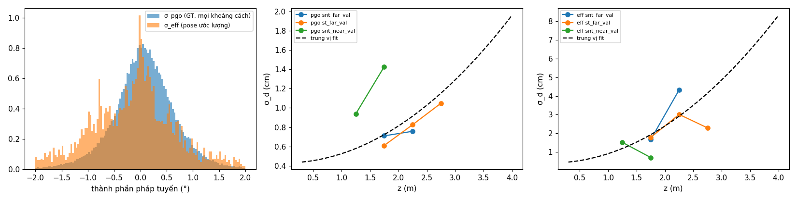

# CALIB_PW2 — hai thang nhiễu (PLAN MONOGS-PW2 §4)

Sinh bằng `tools/monogs/pw2/calib2.py`. Dữ liệu: 3 run `e1c` trên `structure_notexture_far_validation`, `structure_texture_far_validation`, `structure_notexture_near_validation` (frame 0–500). Mặt đo: extractor của SLAM ở mọi frame chia hết cho 5 và mọi keyframe; nhãn mặt thật như R1 (pose GT, 3° / 3 cm).

## Bộ số khóa (`pw2_calib.yaml`)

| Thang | σ_n | σ_d(z) = a + b·z² | Dùng ở |
|---|---|---|---|
| σ_pgo (pose GT, mọi khoảng cách frame) | 0,368° | a = 0,430 cm, b = 0,0958 cm/m² | factor mặt phẳng PGO, kiểm χ² |
| σ_eff (pose ước lượng, như anchor trong SLAM) | 0,830° | a = 0,411 cm, b = 0,4947 cm/m² | kernel, inlier, khởi tạo bền, loss |
| R1 (để so) | 0,240° | a = 0,761 cm, b = 0,0042 cm/m² | |

σ_odo = 1,593 cm / 1,024° (85 cặp keyframe liên tiếp của run e1c; R1 lấy từ base: 3,96 cm / 0,77°). θ_m = 2,779°, δ_m = 4,173 cm (phân vị 99 %, mọi cặp). κ giữ số R1 (2915,7), chỉ để log.

## Từng chuỗi

| Chuỗi | Mặt đo | Nhãn | Cặp (pgo) | σ_pgo,n (°) | a_pgo / b_pgo | σ_pgo ≤ 30 frame: n (°) / d (cm) | Phần dư eff | σ_eff,n (°) | a_eff / b_eff |
|---|---|---|---|---|---|---|---|---|---|
| snt_far_val | 585 | 37 | 12306 | 0,301 | 0,638 / 0,0236 | 0,209 / 0,557 | 462 | 0,982 | 0,000 / 0,7735 |
| st_far_val | 554 | 36 | 11281 | 0,406 | 0,335 / 0,0958 | 0,334 / 0,748 | 447 | 0,675 | 2,539 / 0,0136 |
| snt_near_val | 505 | 25 | 17216 | 0,399 | 0,430 / 0,3261 | 0,314 / 0,783 | 452 | 0,751 | 0,411 / 0,4947 |

**Theo khoảng cách frame** (σ_n °, σ_d cm, số cặp):

| Chuỗi | Thang | 1–30 | 31–100 | 101–300 | 301–… |
|---|---|---|---|---|---|
| snt_far_val | σ_pgo | 0,209 / 0,557 (2651) | 0,271 / 0,670 (4268) | 0,350 / 0,730 (4997) | 0,550 / 1,013 (390) |
| snt_far_val | σ_eff | 0,720 / 1,237 (82) | 0,814 / 2,389 (153) | 1,132 / 3,261 (197) | 0,810 / 3,614 (30) |
| st_far_val | σ_pgo | 0,334 / 0,748 (2213) | 0,372 / 0,802 (3837) | 0,464 / 0,878 (4734) | 0,567 / 1,169 (497) |
| st_far_val | σ_eff | 0,620 / 3,011 (61) | 0,566 / 2,043 (125) | 0,669 / 3,098 (197) | 0,671 / 3,517 (64) |
| snt_near_val | σ_pgo | 0,314 / 0,783 (2586) | 0,378 / 0,908 (4875) | 0,439 / 1,012 (8135) | 0,426 / 1,135 (1620) |
| snt_near_val | σ_eff | 0,223 / 0,631 (39) | 0,717 / 2,014 (90) | 0,719 / 1,387 (220) | 1,016 / 2,289 (103) |

**σ_d theo độ sâu** (cm, số cặp):

| Chuỗi | Thang | Các khoảng z (tâm, m) |
|---|---|---|
| snt_far_val | σ_pgo | 1,75: 0,710 (6465); 2,25: 0,757 (5821) |
| snt_far_val | σ_eff | 1,75: 1,664 (222); 2,25: 4,324 (232) |
| st_far_val | σ_pgo | 1,75: 0,610 (1466); 2,25: 0,826 (7729); 2,75: 1,049 (2077) |
| st_far_val | σ_eff | 1,75: 1,778 (69); 2,25: 3,008 (250); 2,75: 2,288 (125) |
| snt_near_val | σ_pgo | 1,25: 0,939 (15682); 1,75: 1,428 (1534) |
| snt_near_val | σ_eff | 1,25: 1,512 (397); 1,75: 0,699 (54) |

## Kiểm offline kernel (chỉ báo)

| Chuỗi | σ_eff: % cặp đúng nhãn có e ≤ 3 (số cặp) | σ_eff: % anchor sai nhãn trong cổng có e ≤ 3 (số) | σ R1: đúng nhãn | σ R1: sai nhãn |
|---|---|---|---|---|
| snt_far_val | 75,8 (458) | 47,5 (1564) | 22,9 | 14,8 |
| st_far_val | 88,7 (444) | 54,6 (1054) | 20,9 | 12,4 |
| snt_near_val | 70,8 (448) | 34,8 (902) | 34,6 | 12,9 |

**Độ nhạy theo chất lượng tracking** (σ_eff đo bằng pose của run `base` hiệu chỉnh R1, frame 0–300; chỉ báo):

| Chuỗi | σ_eff,n (°) | σ_eff,d (cm, mọi z) | Phần dư |
|---|---|---|---|
| snt_far_val | 0,832 | 2,805 | 184 |
| st_far_val | 0,598 | 2,116 | 201 |

